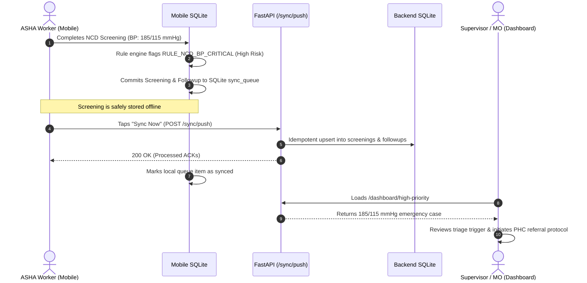

# ASHA AI Copilot — Supervisor Command Center & Implementation Guide

This document describes the architecture, implementation, clinical surveillance workflows, API contracts, security controls, and manual testing procedures for the **Supervisor Command Center** (`apps/dashboard/index.html` & `services/api/main.py`).

---

## 1. Overview & Purpose

The **Supervisor Command Center** provides Primary Health Centre (PHC) Medical Officers (MO) and ASHA Lady Health Visitors (LHV) with a centralized, real-time command dashboard for community-level health surveillance.

```text
  ┌──────────────────────────────────────────────────────────────┐
  │                 ASHA Mobile Devices (Offline)                 │
  │     • Voice Screening   • Vital Signs   • Follow-up Tasks    │
  └──────────────────────────────┬───────────────────────────────┘
                                 │ HTTP POST /sync/push (Batch)
                                 ▼
  ┌──────────────────────────────────────────────────────────────┐
  │                  FastAPI Backend (:8000)                     │
  │     • Idempotent Sync Ingestion   • JWT Authentication       │
  │     • Protocol Rule Validation    • SQLite Cloud Database    │
  └──────────────────────────────┬───────────────────────────────┘
                                 │ Protected Endpoints
                                 ▼
  ┌──────────────────────────────────────────────────────────────┐
  │         Supervisor Web Command Center (/dashboard)           │
  │     • Real-time Triage Board     • Field Worker Heatmap      │
  │     • Follow-up Care Tracking    • Safe DOM / Zero-XSS UI    │
  └──────────────────────────────────────────────────────────────┘
```

### Core Architecture Principles:
1. **Decoupled Offline-First Surveillance:** The dashboard only displays records verified and ingested by the server. It never implies an offline record is visible until the worker syncs.
2. **Deterministic Protocol Highlighting:** High-priority triage cases are classified by deterministic clinical rules (`packages/shared/src/engine.ts`), never autonomous LLM hallucinations.
3. **Role-Based Security:** Dashboard endpoints require authenticated supervisor sessions guarded by JWT tokens.
4. **Resilient Browser Operations:** Automatic pause on background tabs (Page Visibility API) to prevent battery/memory exhaustion on supervisory terminals.

---

## 2. Supervisor Web Interface Architecture

* **Source File:** [`apps/dashboard/index.html`](file:///d:/ASHA%20AI%20COPILOT/ASHA-AI-COPILOT/apps/dashboard/index.html)
* **Serving Route:** `GET /dashboard` (served via FastAPI `FileResponse` with strict Content Security Policy headers).
* **Styling & Assets:** Tailwind CSS, Material Symbols Outlined, Inter font.

### UI Subsystems & Layout

```text
┌──────────────────────────────────────────────────────────────────────────────┐
│  HEADER: आशा ASHA AI Copilot · PHC Rampur Surveillance  [Live Sync Active] [Refresh]│
├──────────────────────────────────────────────────────────────────────────────┤
│  KPI ROW:                                                                    │
│  ┌──────────────┐  ┌──────────────┐  ┌──────────────┐  ┌──────────────┐      │
│  │Total Patients│  │  Screenings  │  │  High-Risk   │  │   Pending    │      │
│  │     14       │  │      17      │  │      3       │  │  Follow-ups  │      │
│  └──────────────┘  └──────────────┘  └──────────────┘  └──────────────┘      │
├─────────────────────────────────────────────────┬────────────────────────────┤
│  URGENT TRIAGE & DANGER SIGN REFERRALS (Table)  │ FIELD WORKER DEPLOYMENT    │
│  • Beneficiary Name, Age, Sex                   │ • Worker Name & Badge ID   │
│  • Village & Contact Phone                      │ • Assigned Catchment Sector│
│  • Clinical Rule Trigger (e.g. Severe BP 180)   │ • Catchment Screenings     │
│  • Due Date & Referral Urgency                  │ • Last Sync Timestamp      │
│  • Action: [View Clinical Summary]              │                            │
└─────────────────────────────────────────────────┴────────────────────────────┘
```

---

## 3. Backend API Contracts & Data Flow

The dashboard consumes three core API endpoints declared in [`services/api/main.py`](file:///d:/ASHA%20AI%20COPILOT/ASHA-AI-COPILOT/services/api/main.py), guarded by `get_current_user` dependency:

### 3.1 `GET /dashboard/summary`
Returns high-level aggregate metrics across the health catchment area.

**Response Schema (`DashboardSummary`):**
```json
{
  "total_patients": 14,
  "total_screenings": 17,
  "high_priority_cases": 3,
  "pending_followups": 3,
  "active_workers": 2,
  "sync_queue_pending": 0
}
```

### 3.2 `GET /dashboard/high-priority`
Queries all uncompleted high-risk follow-up cases triggered by clinical screening rules.

**SQL Query:**
```sql
SELECT f.*, p.name as patient_name, p.village as patient_village, p.phone as patient_phone,
       s.screening_type, s.summary as screening_summary
FROM followups f
JOIN patients p ON f.patient_id = p.id
LEFT JOIN screenings s ON f.screening_id = s.id
WHERE f.priority = 'high' AND f.status = 'pending'
ORDER BY f.due_date ASC
```

**Returned Object Fields:**
- `patient_name`: Full beneficiary name.
- `patient_village`: Village / Tola location.
- `patient_phone`: Mobile contact.
- `reason`: Exact bilingual clinical trigger (e.g. *"Severe Blood Pressure Elevation (180/115 mmHg)"*).
- `priority`: `'high'`.
- `due_date`: Scheduled date for Medical Officer review or referral verification.
- `destination`: Referral destination (`'phc'`, `'chc'`, `'district_hospital'`).
- `urgency`: Referral urgency (`'immediate'`, `'urgent'`, `'routine'`).

### 3.3 `GET /dashboard/workers`
Returns field worker activity, assigned catchment villages, total screenings performed in their catchment, and their most recent synchronization timestamp.

**Response Schema Item:**
```json
{
  "id": "w-001",
  "name": "सुनीता देवी (Sunita Devi)",
  "village": "रामपुर",
  "sub_center": "उप-केंद्र रामपुर-ए",
  "phone": "9876543210",
  "screening_count": 12,
  "last_sync_time": "2026-10-10T00:07:42.128Z"
}
```

---

## 4. Security & Safety Implementations

1. **Content Security Policy (CSP):**
   - Injected in [`services/api/main.py`](file:///d:/ASHA%20AI%20COPILOT/ASHA-AI-COPILOT/services/api/main.py#L60-L70):
     `default-src 'self' 'unsafe-inline' https://cdn.tailwindcss.com; img-src 'self' data: https:;`
   - Blocks unauthorized cross-origin script injection.
2. **Safe DOM Construction (Anti-XSS):**
   - The dashboard script avoids vulnerable `innerHTML` templates when rendering patient data. It uses `document.createElement()`, `textContent`, and `replaceChildren()` to render beneficiary names, villages, and phone numbers safely.
3. **Background Tab Polling Suspension:**
   - Detects `document.hidden` using the HTML5 Page Visibility API. Backgrounded browser tabs halt polling requests, saving server load and client RAM.

---

## 5. End-to-End Operational Workflow



---

## 6. How to Run and Verify the Supervisor Dashboard

### Step 1: Launch Backend
From the repository root:
```powershell
python -m services.api.main
```
The server will start at `http://127.0.0.1:8000`.

### Step 2: Open Dashboard in Browser
Navigate to:
```text
http://127.0.0.1:8000/dashboard
```

### Step 3: Login Credentials
- **Username:** `supervisor`
- **Password:** `password123`
- **Role:** Supervisor (Medical Officer / LHV)

### Step 4: Verification Checklist
- [ ] **Summary Cards:** Total Patients, Screenings, High-Risk Triage, and Pending Follow-ups populate.
- [ ] **Triage Table:** Any beneficiary with a High Risk screening (e.g. Gopal Das or Suman Bai) appears with red badges showing the exact clinical trigger and due date.
- [ ] **Worker Panel:** Sunita Devi and Anita Kumari appear with their assigned villages and active sync timestamps.
- [ ] **Refresh Button:** Tapping **Refresh** immediately queries the endpoints and updates counts.
- [ ] **Seeding / Reset:** Running `python tests/sync_idempotency_test.py` or clicking re-sync simulates live mobile data uploads that reflect immediately upon dashboard refresh.
