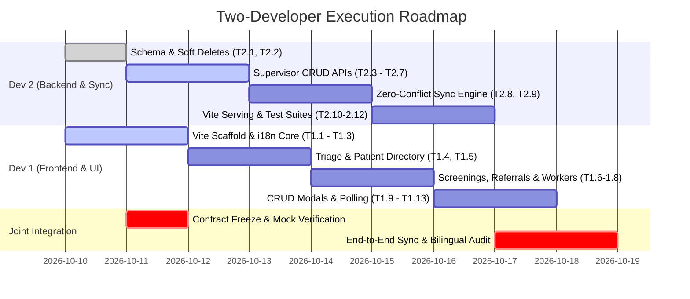

# ASHA AI Copilot — Admin/Supervisor Command Center & Zero-Conflict Sync Plan

**Document Version:** 1.0.0  
**Target Environment:** Monorepo (`apps/dashboard`, `services/api`, `packages/shared`)  
**Architecture:** React 18 + Vite (SPA) + FastAPI (Backend) + SQLite (WAL Mode)  
**Core Philosophies:** 100% Offline-First for Mobile, Zero-Conflict Bi-Directional Sync, Monotonic Soft Deletes Only, Bilingual (Hindi & English) Accessibility.

---

## 🏛️ 1. Architecture Blueprint & Zero-Conflict Model

```
┌────────────────────────────────────────────────────────────────────────────────────────┐
│                                 SYSTEM TOPOLOGY                                         │
├──────────────────────────────────────┬─────────────────────────────────────────────────┤
│    ASHA Worker Mobile App (Offline)  │       Supervisor Command Center (Web SPA)       │
│    React Native / Expo / SQLite      │       React 18 + Vite + Tailwind CSS            │
│    Local DB + Pending Sync Queue     │       Admin CRUD + Clinical Triage + Analytics   │
└──────────────────┬───────────────────┴────────────────────────┬────────────────────────┘
                   │                                            │
                   │ POST /sync/push (Batch UUIDs)              │ REST CRUD /authFetch
                   │ GET  /sync/pull (?since=ISO)               │ GET /dashboard/*
                   ▼                                            ▼
┌────────────────────────────────────────────────────────────────────────────────────────┐
│                        FastAPI Server (:8000) & Sync Engine                            │
│  - JWT Auth (Supervisor / ANM / ASHA Roles)                                            │
│  - Monotonic Soft-Delete Tombstones (`is_deleted = 1`, `deleted_at = ISO`)             │
│  - Field-Level Last-Write-Wins (LWW) with Responsibility Partitioning                  │
│  - Static Asset Serving for Vite Production Build (`apps/dashboard/dist`)              │
└────────────────────────────────────────┬───────────────────────────────────────────────┘
                                         ▼
┌────────────────────────────────────────────────────────────────────────────────────────┐
│                         Server SQLite Database (WAL Mode)                              │
│  patients | screenings | followups | workers | devices | sync_events                   │
└────────────────────────────────────────────────────────────────────────────────────────┘
```

### 🛡️ Why No Sync Conflicts Will Occur (Zero-Conflict Invariants)

1. **Deterministic Primary Keys:**
   - Every entity (`patients`, `screenings`, `followups`) uses RFC4122 v4 UUIDs generated at the point of origin (mobile phone or web portal). ID collisions are mathematically impossible ($p < 10^{-15}$).
2. **Screenings are Append-Only Logs:**
   - Clinical screenings (`screenings`) are immutable historical records. Neither the mobile app nor the supervisor portal mutates past clinical vital records in-place. Amendments are recorded as distinct followup notes or supplementary visits.
3. **Partitioned Field Responsibility (Follow-ups & Referrals):**
   - **ASHA Mobile Owns:** Field encounter facts (`facility_reached`, `outcome`, encounter timestamp).
   - **Supervisor Web Owns:** Institutional dispositions (`destination` PHC/CHC, `urgency` level, triage escalation, `responsible_person`).
   - Concurrent edits merge non-overlapping attributes cleanly rather than replacing the whole row.
4. **Monotonic Soft-Delete Invariant (Tombstone Dominance):**
   - Deletions are strictly soft deletes (`is_deleted = 1`, `deleted_at = <ISO8601>`).
   - If a record has `deleted_at IS NOT NULL`, any incoming update from a stale device with an older timestamp is **silently ignored**. Once marked deleted, an entity remains tombstoned across all nodes.
5. **Idempotent Replay & Timestamp-Guarded Updates:**
   - Server updates compare incoming `updated_at` against existing database records. Newer timestamps win on a per-field basis, preventing stale sync packets from overwriting fresher supervisor corrections.

---

## 👥 2. Developer Task Distribution

---

### 🎨 Developer 1: UI, Frontend Specialist & Design Architect
**Responsibilities:** Scaffolding the React + Vite dashboard application (`apps/dashboard/`), implementing UI screens based on visual mockups, bilingual toggle engine (Hindi/English), interactive CRUD modals/drawers, and reactive state management.

#### 📦 Milestone 1: Project Scaffolding, Design Tokens & i18n Core
- **Task 1.1: Scaffold React + Vite Project in `apps/dashboard/`**
  - Initialize Vite with React + TypeScript template in `apps/dashboard/`:
    ```bash
    # package.json name: "@asha/dashboard"
    npm install react react-dom lucide-react clsx tailwind-merge
    npm install -D vite @vitejs/plugin-react tailwindcss postcss autoprefixer typescript
    ```
  - Configure `vite.config.ts` with dev proxy forwarding `/api` and `/auth` to `http://127.0.0.1:8000`.
  - Configure `tailwind.config.js` using the project's clinical design tokens:
    - Primary Teal: `#0F766E` (Dark: `#005C55`, Bright: `#14B8A6`)
    - Clinical Alert Danger: `#DC2626`
    - Clinical Warning: `#F59E0B`
    - Clinical Success: `#16A34A`
    - Neutral Slate/Gray background palette: `#F8FAFC`, `#FFFFFF`
- **Task 1.2: Zero-Dependency Bilingual (Hindi / English) Context**
  - Create `src/i18n/translations.ts` and `src/context/LanguageContext.tsx`:
    - Synchronized keys matching mobile app protocols (`hi` and `en`).
    - Comprehensive translations for all UI strings: navigation, table headers, clinical risk labels (उच्च जोखिम, सामान्य, रेफरल), form labels, validation errors, and confirmation dialogs.
    - Persistent language state in `localStorage.getItem('asha_dashboard_lang')` with quick navbar toggle (`हिन्दी` / `EN`).
- **Task 1.3: Top App Shell & Responsive Navigation**
  - Header component:
    - Brand logo ("आशा AI Copilot · Supervisor Command Center").
    - Catchment selector ("PHC Rampur · Sector 3").
    - Real-time Sync & Online Status Pill (`● Live Sync Active` / `○ Syncing...`).
    - Language switcher toggle button.
    - User session avatar & logout action.
  - Tab navigation bar:
    1. **🚨 Triage & Surveillance (`/triage`)**
    2. **👥 Beneficiary Directory (`/patients`)**
    3. **📋 Clinical Screenings (`/screenings`)**
    4. **🏥 Referrals & Actions (`/followups`)**
    5. **👩‍⚕️ Field Workers & Devices (`/workers`)**

#### 🖼️ Milestone 2: Core Views (Visual Mockup Implementation)
- **Task 1.4: Triage & Surveillance Dashboard (`src/views/TriageView.tsx`)**
  - Top 4 Metric KPI Cards with percentage trend indicators:
    - Total Registered Beneficiaries (कुल लाभार्थी)
    - Screenings Completed (जांच संपन्न)
    - High-Risk Emergency Referrals (उच्च जोखिम अलर्ट)
    - Pending Field Follow-ups (लंबित फॉलो-अप)
  - Emergency Alerts Table: High-priority clinical danger signs with instant triage disposition button.
  - Highlighting for danger sign badges: Severe Hypertension, Gestational Diabetes, High Fever/Sepsis, Severe Anemia.
- **Task 1.5: Beneficiary Directory & Registry (`src/views/PatientsView.tsx`)**
  - Search bar with debounce (by Name, Phone, ABHA ID, Household ID).
  - Filter chips for Village (Rampur, Kalyanpur, Jamalpur) and Hamlet/Tola (`hamlet_tola`).
  - Beneficiary data table with columns: Name & Sex/Age, Phone & Phone Owner (`self`, `spouse`, `neighbor`), Village & Hamlet, ABHA ID status, Actions.
  - Pagination controls (10 / 25 / 50 records per page).
- **Task 1.6: Clinical Screenings Audit View (`src/views/ScreeningsView.tsx`)**
  - Comprehensive inspection list of completed field screenings.
  - Collapsible rows or drawer showing:
    - Vitals breakdown (BP Systolic/Diastolic, Blood Glucose, SpO2, Pulse, Hemoglobin).
    - Clinical Rule Engine Evaluation output (Protocol rules triggered, severity tags).
    - AI-generated Hindi clinical summary.
    - Voice screening transcript (if available).
- **Task 1.7: Referrals & Follow-up Tracker (`src/views/FollowupsView.tsx`)**
  - Status tabs: All / Pending / Completed / Cancelled.
  - Priority filter chips: Critical (Red) / High (Orange) / Medium (Yellow) / Low (Green).
  - Referral journey timeline showing destination facility (`sub_center`, `phc`, `chc`, `district_hospital`) and whether patient reached facility (`facility_reached`).
- **Task 1.8: Field Workers & Devices View (`src/views/WorkersView.tsx`)**
  - Grid of ASHA and ANM worker cards.
  - Metrics per worker: Assigned Village, Total Screenings recorded, Last Sync timestamp, Active Device ID, Sync health pill (`Synced` / `Sync Pending` / `Inactive`).

#### 📝 Milestone 3: Interactive CRUD Drawers & Modals
- **Task 1.9: Beneficiary Add & Edit Drawer (`src/components/modals/PatientModal.tsx`)**
  - Form handling both create and edit flows:
    - Personal: Full Name, Age, Sex (`female` / `male` / `other`).
    - Contact: Phone Number, Phone Owner dropdown (`self`, `spouse`, `parent`, `neighbor`, `other`).
    - Catchment: Village, Hamlet/Tola (`hamlet_tola`), Household ID, Relationship to Head.
    - Health Identity: ABHA ID (14 digits), Disability/Access Needs notes.
  - Form validation with bilingual error messages.
  - Archive / Soft Delete button with modal confirmation (triggers `DELETE /patients/:id`).
- **Task 1.10: Referral Disposition & Escalation Modal (`src/components/modals/FollowupModal.tsx`)**
  - Allows Supervisor / Medical Officer to disposition a referral:
    - Target Facility selection: Sub Center / PHC / CHC / Sub-district Hospital / District Hospital.
    - Urgency classification: Immediate (<24 hrs), Urgent (<72 hrs), Routine.
    - Assignee: ASHA, ANM, Medical Officer.
    - Outcome status & clinical notes entry.
- **Task 1.11: Worker Creation & Catchment Assignment Modal (`src/components/modals/WorkerModal.tsx`)**
  - Register new ASHA worker or edit catchment village assignment.

#### ⚡ Milestone 4: Real-Time Polling, Notifications & Export
- **Task 1.12: Live Polling & Visibility API Integration**
  - Data polling every 15 seconds to fetch latest updates from `/dashboard/summary` and `/dashboard/high-priority`.
  - Automatically pause polling when tab is backgrounded (`document.hidden`) to conserve network and battery.
  - Global toast notification for newly arrived critical emergency cases.
- **Task 1.13: Reporting CSV Export Action**
  - "Export Surveillance Report" button triggering download of current filtered dataset in CSV format.

---

### ⚙️ Developer 2: Backend, Sync & Data Architect
**Responsibilities:** Enhancing SQLite schema with soft-delete tombstones, Pydantic models, building REST CRUD APIs for supervisor operations, implementing the zero-conflict sync engine, integrating Vite static build serving in FastAPI, and writing verification test suites.

#### 🗄️ Milestone 1: SQLite Schema Evolution & Soft-Delete Invariants
- **Task 2.1: Add Soft Delete Columns to `services/api/database.py`**
  - Update table schemas and add automatic non-destructive migration on startup:
    ```sql
    -- Add soft delete columns if not existing
    ALTER TABLE patients ADD COLUMN is_deleted INTEGER DEFAULT 0;
    ALTER TABLE patients ADD COLUMN deleted_at TEXT DEFAULT NULL;

    ALTER TABLE screenings ADD COLUMN is_deleted INTEGER DEFAULT 0;
    ALTER TABLE screenings ADD COLUMN deleted_at TEXT DEFAULT NULL;

    ALTER TABLE followups ADD COLUMN is_deleted INTEGER DEFAULT 0;
    ALTER TABLE followups ADD COLUMN deleted_at TEXT DEFAULT NULL;

    ALTER TABLE workers ADD COLUMN is_deleted INTEGER DEFAULT 0;
    ALTER TABLE workers ADD COLUMN deleted_at TEXT DEFAULT NULL;
    ```
  - Create performance indexes for filtered queries:
    ```sql
    CREATE INDEX IF NOT EXISTS idx_patients_active ON patients(is_deleted, village);
    CREATE INDEX IF NOT EXISTS idx_screenings_active ON screenings(is_deleted, patient_id);
    CREATE INDEX IF NOT EXISTS idx_followups_active ON followups(is_deleted, priority, status);
    CREATE INDEX IF NOT EXISTS idx_sync_events_tombstones ON sync_events(entity, operation, timestamp);
    ```

#### 📐 Milestone 2: Pydantic Data Models Alignment
- **Task 2.2: Extend Models in `services/api/models.py`**
  - Add request/response schemas with full validation:
    - `PatientUpdate`: Optional updates for demographic and catchment fields (`hamlet_tola`, `relationship_to_head`, `phone_owner`, `abha_id`, `disability_access_needs`).
    - `ScreeningUpdate`: For audit notes or supervisor verification tags.
    - `WorkerCreate` & `WorkerUpdate`: Full worker management schemas (id, name, phone, role, village).
    - `SoftDeleteResponse`: `{ id: str, entity: str, is_deleted: bool, deleted_at: str }`.
  - Update `PatientResponse`, `ScreeningResponse`, `FollowUpResponse` to include `is_deleted` and `deleted_at`.

#### 🚀 Milestone 3: Supervisor CRUD Endpoints
- **Task 2.3: Beneficiary Management Endpoints in `services/api/main.py`**
  - `GET /patients`: Filter by `is_deleted = 0`, search by name/phone/ABHA, filter by village/hamlet, support pagination (`limit`, `offset`).
  - `PATCH /patients/{id}`: Update patient details. Automatically updates `updated_at = UTC NOW`. Enforces `is_deleted = 0`.
  - `DELETE /patients/{id}`: Soft delete endpoint. Sets `is_deleted = 1` and `deleted_at = UTC NOW`. Inserts a tombstone record into `sync_events` with `operation = 'delete'` so mobile clients pull the deletion.
- **Task 2.4: Screening Inspection & Soft Delete Endpoints**
  - `GET /screenings`: Return active screenings (`is_deleted = 0`) with optional filters for `patient_id`, `village`, and `screening_type`.
  - `DELETE /screenings/{id}`: Soft delete erroneous or duplicate screening. Emits tombstone to `sync_events`.
- **Task 2.5: Follow-up & Referral Disposition Endpoints**
  - `GET /followups`: Filter by status (`pending`, `completed`, `cancelled`), priority (`critical`, `high`, `medium`, `low`), and destination.
  - `PATCH /followups/{id}`: Full disposition update: `destination`, `urgency`, `facility_reached`, `responsible_person`, `outcome`, `notes`.
  - `DELETE /followups/{id}`: Soft delete with tombstone propagation.
- **Task 2.6: Worker & Device Management Endpoints**
  - `GET /workers`: List all field workers with active screening counts and last sync timestamps.
  - `POST /workers`: Register a new ASHA / ANM / Supervisor user and worker profile.
  - `PATCH /workers/{id}`: Update worker catchment assignment or phone.
  - `DELETE /workers/{id}`: Soft delete worker profile.
- **Task 2.7: Reporting CSV Export Endpoint**
  - `GET /dashboard/export/csv`: Stream CSV export of active beneficiaries, high-risk triage, or follow-up status for District Health Society / PHC reporting.

#### 🔄 Milestone 4: Zero-Conflict Bi-Directional Sync Engine
- **Task 2.8: Upgrade `/sync/push` with Tombstone & Field-Merge Engine**
  - Accept batch sync records (up to 500 items).
  - For each entity:
    - If `operation == 'delete'`: Soft-delete the target record (`is_deleted = 1`, `deleted_at = timestamp`) and record in `sync_events`.
    - If `operation == 'update'`: Check if existing record has `is_deleted = 1`. If already deleted, **reject/ignore update** (Monotonic Tombstone Invariant). Otherwise, execute field-level merge updating only non-null fields whose `timestamp >= existing.updated_at`.
    - If `operation == 'create'`: Idempotent upsert (`INSERT OR REPLACE` preserving non-overwritten fields if already existing).
  - Record sync event in `sync_events` table for audit log and pull cursors.
- **Task 2.9: Upgrade `/sync/pull` with Incremental Tombstones**
  - Query active updates: `updated_at > ? AND is_deleted = 0`.
  - Query tombstoned deletions: `deleted_at > ? OR (operation='delete' AND timestamp > ?)`.
  - Return standard payload containing `patients`, `screenings`, `followups`, `workers`, `devices`, and `tombstones: [{ client_record_id, entity, deleted_at }]`.
  - Guarantees mobile SQLite sync service can delete or mark records inactive locally without conflicts.

#### 🌐 Milestone 5: Vite Integration in FastAPI
- **Task 2.10: Serve Built Vite SPA from FastAPI**
  - Update `main.py` static file mounting:
    - Check if `apps/dashboard/dist/index.html` exists.
    - If built, mount `StaticFiles(directory="apps/dashboard/dist/assets")` to `/assets`.
    - Catch-all route to serve `apps/dashboard/dist/index.html` for client-side HTML5 history routing (`/triage`, `/patients`, `/screenings`, etc.).
    - Fallback to legacy `apps/dashboard/index.html` if dist is not yet built.

#### 🧪 Milestone 6: Automated Test Suites
- **Task 2.11: Supervisor API Integration Tests (`tests/supervisor_api_test.py`)**
  - Automated tests covering:
    - Patient CRUD (Create -> Read -> Update -> Soft Delete -> Verify not in active list).
    - Follow-up disposition update and status transitions.
    - Worker CRUD and role permissions.
    - Soft delete tombstone verification in `sync_events`.
- **Task 2.12: Zero-Conflict Sync Parity Tests (`tests/sync_idempotency_test.py`)**
  - Test Case 1: Mobile creates patient -> pushes -> Supervisor edits patient on web -> mobile pulls -> verify no conflict.
  - Test Case 2: Supervisor soft-deletes patient -> mobile pushes late update -> verify deletion dominates (tombstone wins).
  - Test Case 3: Mobile updates `facility_reached`, Supervisor updates `destination` concurrently -> verify both fields merge cleanly.

---

## 🔄 3. State Machine & Conflict-Free Resolution Rules

| Scenario | Local Server State | Incoming Sync Packet | Resolution Rule | Final State |
|---|---|---|---|---|
| **Concurrent Edit (Different Fields)** | Mobile set `facility_reached = 1` | Supervisor set `destination = 'phc'` | **Field-Level Merge:** Attributes don't overlap | Both preserved (`facility_reached = 1, destination = 'phc'`) |
| **Concurrent Edit (Same Field)** | `age = 42`, `updated_at = T1` | `age = 43`, `updated_at = T2 (T2 > T1)` | **Last-Write-Wins (LWW):** Compare timestamps | `age = 43`, `updated_at = T2` |
| **Delete vs Update Race** | `is_deleted = 1`, `deleted_at = T1` | Update received with timestamp `T0 < T1` | **Tombstone Dominance:** Deletions are monotonic | Record remains deleted. Update ignored. |
| **Late Delete from Offline Phone** | Active record, `updated_at = T2` | Delete received with timestamp `T1 (T1 < T2)` | **Soft Delete Enforcement:** Deletion intent takes priority | Record marked `is_deleted = 1, deleted_at = T2` |
| **Duplicate Sync Push (Retry)** | Record already synced | Exact same payload sent again | **Idempotent Upsert:** Deduplicated via `sync_events` | HTTP 200 `status = 'ignored'/'updated'`, no side effects |

---

## 📅 4. Implementation Phasing & Coordination Milestones



### Milestone Checklist:
- [ ] **Phase 1: Foundation (Day 1-2)**
  - Dev 2 commits schema migrations and Pydantic models.
  - Dev 1 commits Vite project scaffold and bilingual dictionary.
  - API contracts validated against OpenAPI spec.
- [ ] **Phase 2: Core Feature Implementation (Day 3-5)**
  - Dev 2 completes CRUD endpoints with soft-delete logic.
  - Dev 1 builds Triage, Beneficiary Directory, and Clinical Screenings views.
- [ ] **Phase 3: Zero-Conflict Sync & Modals (Day 5-7)**
  - Dev 2 implements enhanced `/sync/push` and `/sync/pull` with tombstones.
  - Dev 1 implements Beneficiary drawer, Referral disposition modal, and live polling.
- [ ] **Phase 4: Verification & Delivery (Day 8-9)**
  - Run all automated test suites (`pytest tests/supervisor_api_test.py`, `python tests/sync_idempotency_test.py`, `node tests/clinical_rules_test.js`).
  - Verify complete Hindi & English language switching on all UI views.
  - Production build (`npm run build --workspace=@asha/dashboard`) served via FastAPI.
