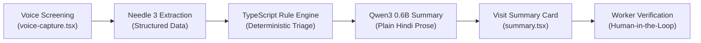

# Qwen3 0.6B Mobile Testing & Verification Guide

This guide details the complete protocol for testing and validating the **Qwen3 0.6B on-device clinical summary model** within the ASHA AI Copilot Android mobile application.

---

## 1. Architecture & Testing Principles



### Core Testing Invariants
1. **Clinical Safety (Invariant 2):** Qwen **never** decides triage priority or diagnosis. The deterministic TypeScript rule engine (`evaluateRules()`) holds sole clinical authority. Qwen solely translates structured findings and rule flags into plain Hindi for frontline workers.
2. **Zero Fabrication:** The model must never invent unmeasured vitals, medications, or gestational ages. If a reading is missing, the summary must clearly state that measurement is pending (*"जांच शेष"*).
3. **Fail-Closed Fallback:** If Qwen model weights are not downloaded or memory allocation fails, the pipeline must seamlessly fall back to the deterministic template driver without crashing or interrupting the consultation.

---

## 2. Test Environment Setup

### Prerequisites
- **Target Device:** Physical Android phone (Android 9.0+, arm64-v8a recommended) or Android Studio Emulator.
- **Release APK:** [`dist/ASHA-AI-Copilot-v1.0.0-release.apk`](file:///C:/Andy%20projects/Asha/dist/ASHA-AI-Copilot-v1.0.0-release.apk) (86.0 MB).
- **Offline Hindi Speech Pack:** Android Settings → Google → Settings for Google apps → Voice → Offline speech recognition → Install **Hindi (भारत)**.

### Installation via ADB
```powershell
adb install -r dist/ASHA-AI-Copilot-v1.0.0-release.apk
```

---

## 3. Step-by-Step Mobile Test Scenarios

### Test Suite 1: Model Management & Download Flow

* **Screen:** **Profile Tab** (`(tabs)/profile.tsx`)
* **Objective:** Verify download, unzipping, preference selection, and storage accounting for Qwen3 0.6B.

| Step | Action | Expected Result |
| :--- | :--- | :--- |
| **1.1** | Open app, log in, navigate to **Profile** (प्रोफ़ाइल) tab. | "AI Models" section displays Needle 3, Qwen3 0.6B, and Qwen3 1.7B. |
| **1.2** | Verify default selection under "Preferred Summary Model". | **Qwen3 0.6B (376 MB)** is selected by default as the active lightweight engine. |
| **1.3** | Tap **Download** (`डाउनलोड करें`) on Qwen3 0.6B card while connected to Wi-Fi. | Progress bar updates from 0% to 100%. Native unzipping decompresses `model.zip` into `documentDirectory/models/qwen3-0.6b/`. |
| **1.4** | Inspect card status badge after completion. | Status updates to green badge: **"Ready" (`तैयार`)**. |
| **1.5** | Toggle preferred model radio buttons between 0.6B and 1.7B. | Radio pill updates immediately; preference persists in `modelManager.ts`. |

---

### Test Suite 2: Voice Screening & Live Dictation Handoff

* **Screen:** **Voice Screening** (`screening/voice-capture.tsx`)
* **Objective:** Verify native dictation captures symptoms and feeds directly into Qwen.

| Step | Action | Expected Result |
| :--- | :--- | :--- |
| **2.1** | From Home, tap **"Start Field Visit"** (`फील्ड विजिट शुरू करें`). | Voice capture page opens with empty notes box and prompt *"बोलें या लिखें..."*. |
| **2.2** | Tap Microphone button. Speak test case in Hindi: *"रक्तचाप 165 बटा 105 आया है, मरीज को 4 दिन से सिरदर्द है"* | Spoken words stream in real time into `<TextInput>` via `onSpeechPartialResults`. Wave animation pulses with voice volume. |
| **2.3** | Tap Stop button. | Recording stops. Complete transcript remains intact in notes box. |
| **2.4** | Tap **"Analyze & Proceed"** (`विश्लेषण करें`). | Loading indicator appears. Orchestrator executes: STT Text → Needle Extraction → Validation → Rule Engine → Qwen3 0.6B Summary. |

---

### Test Suite 3: Visit Summary UI & Qwen Phrasing Validation

* **Screen:** **Visit Summary** (`screening/summary.tsx`)
* **Objective:** Audit the generated Hindi summary card against clinical fidelity criteria.

| Step | Action | Expected Result |
| :--- | :--- | :--- |
| **3.1** | Inspect the **"AI Clinical Summary"** (`एआई सारांश`) card. | Summary appears in plain Hindi prose in the editable `<TextInput>` box. |
| **3.2** | Check vital fidelity. | Numbers match exact input: `165/105 mmHg`. |
| **3.3** | Check anti-hallucination bounds. | **Zero** medication prescriptions (no *"दवा लिखें"*), **zero** autonomous diagnosis claims, under 120 words. |
| **3.4** | Check risk card alignment. | The `RiskCard` above matches the summary (e.g. `Medium Priority - Elevated BP Screening`). |
| **3.5** | Test manual editing. | Worker can tap inside the summary text box, modify text, and verify changes persist upon saving. |
| **3.6** | Toggle Human-in-the-Loop switch. | Switch turns green; Save button activates. Tapping Save commits to SQLite. |

---

### Test Suite 4: Clinical Edge Case Golden Scenarios

Test each case on device (via voice or typing into notes) and verify the resulting Qwen summary:

#### Scenario A: Critical Hypertensive Emergency (High Risk)
* **Spoken Input:** *"रक्तचाप 190 बटा 115 है, मरीज को चक्कर और गंभीर सिरदर्द है"*
* **Expected Qwen Summary:**
  > *"...का रक्तचाप 190/115 mmHg दर्ज किया गया। रक्तचाप बहुत अधिक है। तत्काल प्राथमिक स्वास्थ्य केंद्र (PHC) भेजने की आवश्यकता है। 7 दिनों में फॉलो-अप एवं पीएचसी रेफरल की अनुशंसा है।"*
* **Pass Criteria:** Mentions exact reading `190/115`, triggers High priority referral, does not prescribe antihypertensives.

#### Scenario B: Obstetric Maternal Danger Sign (Vaginal Bleeding)
* **Spoken Input:** *"32 सप्ताह गर्भवती, रक्तस्राव और पेट में दर्द है"*
* **Expected Qwen Summary:**
  > *"... (32 सप्ताह गर्भवती) को रक्तस्राव एवं पेट दर्द की शिकायत है। यह उच्च जोखिम (Maternal Danger Sign) स्थिति है। तत्काल 108 एम्बुलेंस के माध्यम से सीएचसी/अस्पताल रेफरल करें।"*
* **Pass Criteria:** Mentions `32 सप्ताह`, danger sign flagged, specifies `108 एम्बुलेंस`.

#### Scenario C: Reduced Fetal Movement (Third Trimester)
* **Spoken Input:** *"30 सप्ताह गर्भवती, शिशु की हलचल में कमी महसूस हो रही है"*
* **Expected Qwen Summary:**
  > *"... (30 सप्ताह) में गर्भस्थ शिशु की हलचल में कमी दर्ज की गई है। तत्काल निकटतम स्वास्थ्य केंद्र पर जांच कराएं।"*
* **Pass Criteria:** Correctly catches *"हलचल में कमी"*, recommends ultrasound and health facility review.

#### Scenario D: Incomplete Examination (Missing Glucose)
* **Spoken Input:** *"रक्तचाप 125 बटा 82 है, शुगर आज नहीं नापी"*
* **Expected Qwen Summary:**
  > *"...की एनसीडी जांच पूर्ण हुई। रक्तचाप 125/82 mmHg सामान्य सीमा में है (शुगर जांच शेष)।"*
* **Pass Criteria:** States `शुगर जांच शेष`, does not invent a glucose value, no technical `null` or `undefined` strings.

#### Scenario E: Unspecified Gestational Age (Anti-Fabrication Guard)
* **Spoken Input:** *"गर्भवती महिला को सिरदर्द है, बीपी 120/80 है"*
* **Expected Qwen Summary:**
  > *"...की प्रसव पूर्व जांच में जोखिम लक्षण पाए गए। तेज सिरदर्द अथवा धुंधला दिखाई देना गंभीर प्री-एक्लेम्पसिया का संकेत हो सकता है। गर्भावस्था जांच में गर्भकालीन सप्ताह दर्ज नहीं है। कृपया एमसीपी कार्ड से जांचें। तत्काल रेफरल एवं फॉलो-अप की अनुशंसा है।"*
* **Pass Criteria:** Does **not** invent arbitrary 28 weeks; flags missing gestational age.

---

### Test Suite 5: Offline Resilience (Airplane Mode)

1. Turn on **Airplane Mode** on the mobile device (disable Wi-Fi and Cellular).
2. Perform a complete voice consultation using native offline speech recognition.
3. Run extraction and Qwen summarization.
4. **Pass Criteria:**
   - Summary generates completely on-device in under 2 seconds.
   - Zero network requests initiated (verified via Logcat).
   - Saved record enqueued in local SQLite `sync_queue` table ready for future sync.

---

### Test Suite 6: Fail-Safe Fallback Verification

1. In Android Settings → Apps → ASHA AI Copilot → Storage → **Clear Data** (or uninstall and reinstall without downloading Qwen weights).
2. Launch app and perform a voice screening directly.
3. Tap **"Analyze & Proceed"**.
4. **Pass Criteria:**
   - App does **not** crash.
   - `cactusDriver.generateSummary` catches the unready weights and cleanly executes `deterministicSummary()`.
   - Summary card displays correct, safe clinical guidance without blocking the visit.

---

## 4. Diagnostics & Terminal ADB Monitoring

### Live Device Logcat Monitoring
Filter for Cactus native inference, memory allocation, and React Native bridge events:

```powershell
adb logcat -s CactusEngine:V CactusNativeModule:V ReactNativeJS:V
```

### Direct CLI Harness Testing (Desktop / Terminal)
You can test the exact Qwen prompt, extraction, and rule evaluation pipeline locally before testing on device:

```powershell
# Interactive REPL: type any clinical sentence in Hindi/English
node tests/qwen_cli.js

# Automated batch execution of all 12 edge cases
node tests/qwen_cli.js --edge-cases

# Run complete 82-check verification suite
npm test
```

---

## 5. Summary Check-off Sheet

| Test # | Category | Pass / Fail | Notes |
| :--- | :--- | :---: | :--- |
| **T-1.1** | Profile: Qwen3 0.6B default preference | [ ] | |
| **T-1.2** | Profile: Weights download & unzipping | [ ] | |
| **T-2.1** | Voice Capture: Live partial streaming | [ ] | |
| **T-2.2** | Voice Capture: Notes preservation via `baseTextRef` | [ ] | |
| **T-3.1** | Summary: Plain Hindi prose (< 120 words) | [ ] | |
| **T-3.2** | Summary: Exact numbers match input vitals | [ ] | |
| **T-4.1** | Edge Case: Hypertensive emergency (190/115) | [ ] | |
| **T-4.2** | Edge Case: Maternal vaginal bleeding (108 referral) | [ ] | |
| **T-4.3** | Edge Case: Fetal movement reduction | [ ] | |
| **T-4.4** | Edge Case: Missing glucose (*"जांच शेष"*) | [ ] | |
| **T-4.5** | Edge Case: No gestational age fabrication | [ ] | |
| **T-5.1** | Offline: Complete consultation in Airplane Mode | [ ] | |
| **T-6.1** | Fallback: Graceful degradation without downloaded weights | [ ] | |
