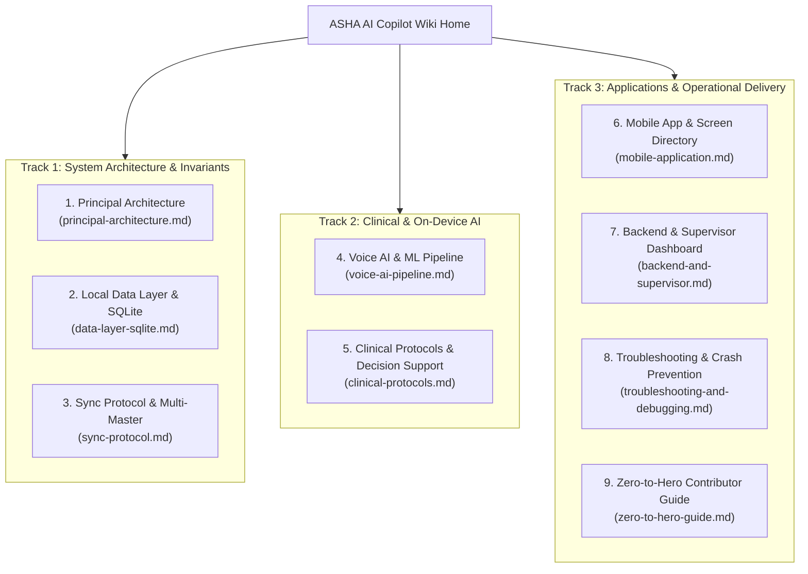
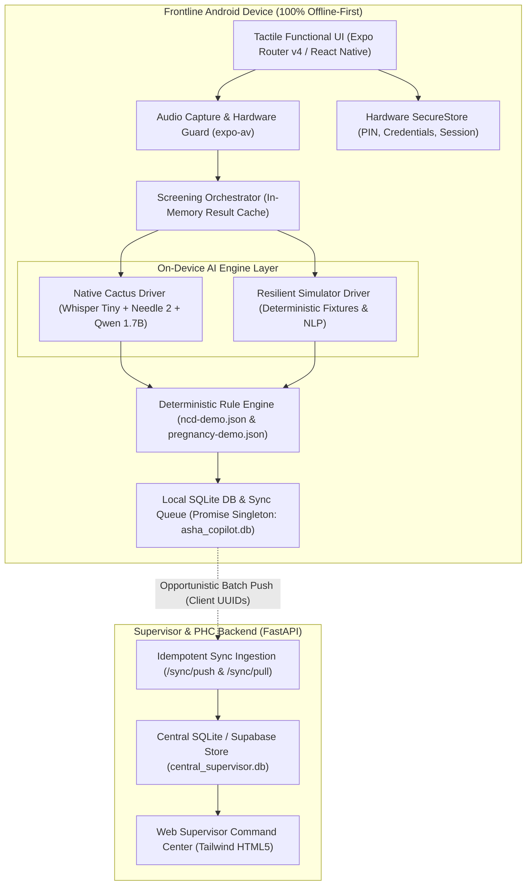

# ASHA AI Copilot — Technical Wiki & Knowledge Base

> **Offline-first Hindi voice-enabled AI copilot for frontline ASHA community healthcare workers**  
> **Repository Context:** `C:\Andy projects\Asha`

Welcome to the central technical documentation wiki for **ASHA AI Copilot**. This knowledge base contains principal-level architectural blueprints, clinical rule specifications, mobile and backend manuals, and debugging guides for engineering teams, medical advisors, and field operations.

---

## 📚 Master Wiki Catalogue & Reading Paths



| Chapter | Document Title | Primary Audience | Key Topics Covered |
| :---: | :--- | :--- | :--- |
| **01** | **[Principal Architecture Guide](./principal-architecture.md)** | Staff / Principal Engineers | The 4 core invariants, high-level component map, load-bearing abstractions, security & data privacy |
| **02** | **[Mobile Application & Screen Directory](./mobile-application.md)** | Mobile Engineers, UI/UX | Expo Router v4 hierarchy, 12 screen specifications, Tactile Functionalism, theme tokens, Purple Ban |
| **03** | **[Voice AI & On-Device ML Pipeline](./voice-ai-pipeline.md)** | AI / ML Engineers | Whisper Tiny Hindi STT, Needle 2 structured extraction, Qwen3-1.7B summary, latency budget (<3.5s) |
| **04** | **[Clinical Protocols & Decision Support](./clinical-protocols.md)** | Doctors, Clinical Advisors, QA | MoHFW guidelines, NCD hypertension/diabetes crisis, maternal danger signs, "Why Was This Flagged?" |
| **05** | **[Local Data Layer & SQLite Persistence](./data-layer-sqlite.md)** | Database Architects | SQLite relational schema, Promise Singleton (`dbPromise`), Repositories, `SecureStore` key dictionary |
| **06** | **[Sync Protocol & Multi-Master Engine](./sync-protocol.md)** | Distributed Systems Leads | Idempotent `/sync/push` & `/sync/pull`, client UUIDs, deduplication guarantees, conflict resolution |
| **07** | **[Backend Services & Supervisor Dashboard](./backend-and-supervisor.md)** | Backend Engineers, MOs | FastAPI endpoints, Web Supervisor Command Center, epidemiological triage KPIs, referral tracking |
| **08** | **[Troubleshooting, Debugging & Crash Prevention](./troubleshooting-and-debugging.md)** | Senior Engineers, QA Leads | Post-mortem of solved audio/nav/DB crashes, ADB logcat filters, on-device SQLite inspection, FAQs |
| **09** | **[Zero-to-Hero Contributor Guide](./zero-to-hero-guide.md)** | New Developers & Contributors | Dev setup, directory layout, running test suites, adding features, compiling signed production release APK |

---

## 🏛️ System High-Level Topology



---

## 🎯 The Four Product Invariants

1. **The Field Invariant (Offline Completeness)**: Under no circumstances does the core clinical screening workflow block on an HTTP network request. Every patient record, voice recording, structured extraction, clinical rule evaluation, and follow-up generation must execute locally and persist immediately to SQLite.
2. **The Clinical Safety Invariant (Deterministic Triage)**: Neural language models (LLMs) are strictly forbidden from determining clinical priority (Normal, Medium, High). Clinical scoring is computed exclusively by deterministic rule algorithms evaluated against codified Ministry of Health & Family Welfare (MoHFW) standards. AI is restricted to transcription, field extraction, and language explanation.
3. **The Privacy Invariant (Ephemeral Audio)**: Raw audio captured during voice consultations is strictly ephemeral. It is processed in temporary sandbox storage and purged once transcription and extraction are verified. Only structured numerical vitals and clinical risk flags are synced to the supervisor backend.
4. **The Network Invariant (Strict Idempotency)**: Due to fluctuating 2G/3G connectivity in rural sub-centers, network drops are expected during synchronization. Every entity uses client-side UUIDs (`p-${Date.now()}`, `screen-${Date.now()}`) and database upsert semantics so that replaying a sync payload produces the exact same state without duplicates.

---

## 🚀 Quick Verification Commands

```powershell
# 1. Verify TypeScript compilation across mobile app
npx tsc --noEmit --project apps/mobile/tsconfig.json

# 2. Run deterministic clinical rule engine test suite
node tests/clinical_rules_test.js

# 3. Verify backend sync idempotency and replay safety
$env:PYTHONIOENCODING="utf-8"; python tests/sync_idempotency_test.py

# 4. Verify production release APK signature
$env:ANDROID_HOME = "C:\Users\naman\AppData\Local\Android\Sdk"
$apksigner = Get-ChildItem -Path "$env:ANDROID_HOME\build-tools" -Filter "apksigner.bat" -Recurse | Select-Object -First 1 -ExpandProperty FullName
& $apksigner verify --verbose "dist\ASHA-AI-Copilot-v1.0.0-release.apk"
```
