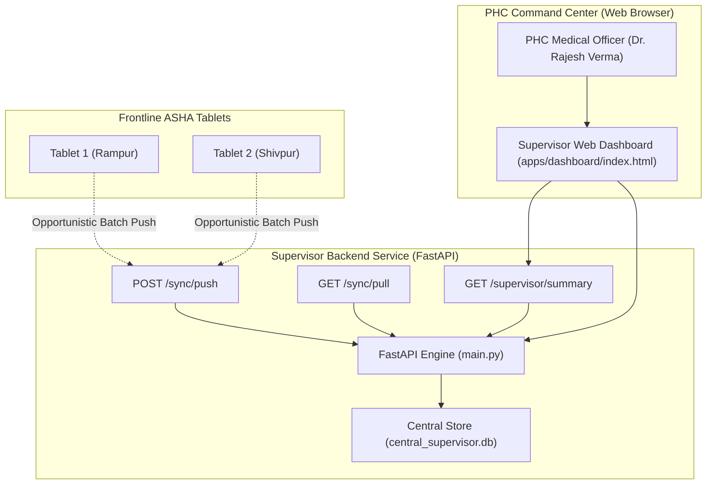

# Backend Services & Supervisor Web Dashboard

> **Audience:** Backend Engineers, System Administrators, PHC Medical Officers  
> **Backend Service:** [`services/api/`](file:///C:/Andy%20projects/Asha/services/api)  
> **Supervisor Web Dashboard:** [`apps/dashboard/index.html`](file:///C:/Andy%20projects/Asha/apps/dashboard/index.html)

---

## 1. System Overview & Architecture

The supervisor tier bridges frontline village screening operations with Primary Health Centre (PHC) clinical administration. Built on **FastAPI (Python 3.10+)** and **Tailwind CSS**, it provides:

1. **Idempotent Sync Ingestion**: Ingests and processes batched offline payloads dispatched from mobile tablets.
2. **Clinical Surveillance Dashboard**: Equips Medical Officers (MOs) with real-time visibility into high-risk maternal obstetric cases and hypertensive emergencies across assigned villages.
3. **Follow-Up Triage Tracking**: Tracks whether referred patients have reached the PHC for physician consultation and medication refills.



---

## 2. API Reference & Endpoint Specifications

### 1. Health & Status
- **`GET /health`**
  - **Description:** Verifies service uptime and database availability.
  - **Response (HTTP 200):**
    ```json
    {
      "status": "healthy",
      "service": "asha-ai-copilot-api",
      "timestamp": "2026-10-06T14:30:00Z"
    }
    ```

### 2. Synchronization Endpoints
- **`POST /sync/push`**
  - **Description:** Ingests an idempotent batch of client operations (`patient`, `screening`, `followup`, `worker`).
  - **Request Schema:** [`SyncPushRequest`](file:///C:/Andy%20projects/Asha/services/api/models.py)
  - **Response (HTTP 200):**
    ```json
    {
      "processed": 3,
      "errors": 0,
      "items": [
        { "client_record_id": "p-1728219482001", "status": "created" },
        { "client_record_id": "screen-1728219482002", "status": "created" },
        { "client_record_id": "foll-1728219482003", "status": "created" }
      ]
    }
    ```

- **`GET /sync/pull`**
  - **Description:** Retrieves server-side changes since a given ISO8601 timestamp.
  - **Query Parameters:** `since` (optional timestamp), `limit` (default 50).

### 3. Clinical Surveillance & Reporting
- **`GET /supervisor/summary`**
  - **Description:** High-level epidemiological indicators for the supervisor command center.
  - **Response (HTTP 200):**
    ```json
    {
      "total_patients": 10,
      "total_screenings": 12,
      "high_risk_cases": 4,
      "pending_followups": 7,
      "completed_followups": 3,
      "active_workers": 2,
      "last_sync": "2026-10-06T14:25:00Z"
    }
    ```

- **`GET /patients` & `POST /patients`**
  - Query parameters: `search` (filter by name/phone/village), `village` (filter by catchment).

- **`GET /screenings` & `POST /screenings`**
  - Query parameters: `patient_id`, `high_risk_only` (boolean filter).

- **`GET /followups` & `PATCH /followups/{id}`**
  - Allows Medical Officers to mark referrals attended or add clinical notes.

---

## 3. Web Supervisor Command Center (`apps/dashboard/index.html`)

The dashboard is served directly by FastAPI at `http://127.0.0.1:8000/` or `http://127.0.0.1:8000/dashboard` and requires zero external build steps (pure HTML5 + Tailwind CDN).

### Key Dashboard Modules:
1. **Live Sync Status Ribbon:**
   - Visual pulsing green badge indicating real-time sync connectivity with field devices.
   - 1-click **Refresh** button fetching updated metrics.
2. **Epidemiological KPI Cards (4 Tiles):**
   - *Total Beneficiaries Tracked* (e.g., `10 Patients`).
   - *High-Risk Triage Alerts* (Highlighted in crimson: `4 Immediate Attention`).
   - *Pending Referrals & Follow-ups* (e.g., `7 Due`).
   - *Active Field Workers* (e.g., `2 Sub-Centers Active`).
3. **Emergency Triage Desk (Priority Cases Table):**
   - Renders patient name, age, village, screening timestamp, and color-coded risk badge:
     - 🔴 **High Priority (गंभीर):** Maternal vaginal bleeding, severe pre-eclampsia, hypertensive crisis ($BP \ge 180/110$).
     - 🟠 **Medium Priority (मध्यम):** Elevated BP ($140/90$), blood glucose $\ge 200$, missed medications.
     - 🟢 **Normal (सामान्य):** Routine checkup within physiological limits.
4. **Follow-Up Management Hub:**
   - Lists scheduled home visits and clinical referrals with a 1-click **"Mark Attended"** action updating the central database.

---

## 4. Running the Backend & Dashboard Locally

### Prerequisites
- Python 3.10+
- Activated virtual environment with dependencies installed:
  ```powershell
  pip install fastapi uvicorn pydantic requests
  ```

### Launch Command
```powershell
# From the repository root C:\Andy projects\Asha:
python -m uvicorn services.api.main:app --host 127.0.0.1 --port 8000 --reload
```

### Access URLs:
- **Supervisor Web Dashboard:** [http://127.0.0.1:8000/](http://127.0.0.1:8000/)
- **Interactive Swagger API Docs:** [http://127.0.0.1:8000/docs](http://127.0.0.1:8000/docs)
- **OpenAPI JSON Spec:** [http://127.0.0.1:8000/openapi.json](http://127.0.0.1:8000/openapi.json)
