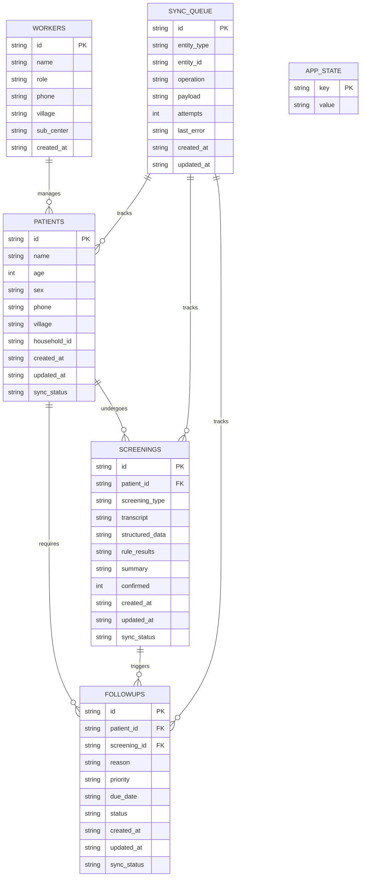

# Local Data Layer & SQLite Persistence Architecture

> **Audience:** Database Architects, Mobile Engineers, Backend Integrators  
> **Source Directory:** [`apps/mobile/services/db/`](file:///C:/Andy%20projects/Asha/apps/mobile/services/db)  
> **Database File:** `asha_copilot.db` (Expo SQLite next)

---

## 1. System Design & Concurrency Model

Frontline community healthcare devices operate under extreme conditions: frequent app task switching, unpredictable background termination by aggressive Android OEM battery savers, and intermittent network access. The data layer is engineered around three non-negotiable principles:

1. **100% Local Durability**: All patient registrations, vital recordings, screening narratives, and follow-up assignments commit to local SQLite storage *before* any network dispatch is scheduled.
2. **Promise-Based Singleton Concurrency**: SQLite file descriptors are susceptible to `SQLiteException: database is locked` if multiple asynchronous components invoke `openDatabaseAsync` concurrently. The database accessor enforces a Promise Mutex pattern:
   ```typescript
   let dbPromise: Promise<SQLite.SQLiteDatabase> | null = null;

   export function getDatabase(): Promise<SQLite.SQLiteDatabase> {
     if (!dbPromise) {
       dbPromise = (async () => {
         try {
           const db = await SQLite.openDatabaseAsync('asha_copilot.db');
           await initDatabase(db);
           return db;
         } catch (err) {
           dbPromise = null; // Reset on error so future retries are clean
           throw err;
         }
       })();
     }
     return dbPromise;
   }
   ```
3. **Defensive Serialization**: JSON fields stored in SQLite (`structured_data`, `rule_results`) are read through safe parsing wrappers (`safeJsonParse()`) preventing corrupted string inputs from crashing UI lists.

---

## 2. Complete Relational Database Schema



---

## 3. Data Dictionary & Table Definitions

### Table: `workers`
Stores active ASHA healthcare workers and supervisor profiles authenticated on the physical device.
```sql
CREATE TABLE IF NOT EXISTS workers (
  id TEXT PRIMARY KEY,
  name TEXT NOT NULL,
  role TEXT NOT NULL,         -- 'asha' | 'supervisor' | 'anm'
  phone TEXT,
  village TEXT NOT NULL,
  sub_center TEXT,
  created_at TEXT NOT NULL
);
```

### Table: `patients`
Beneficiary registry representing residents in the ASHA worker's assigned geographic catchment area.
```sql
CREATE TABLE IF NOT EXISTS patients (
  id TEXT PRIMARY KEY,        -- Client UUID: p-{timestamp}
  name TEXT NOT NULL,
  age INTEGER,
  sex TEXT NOT NULL,          -- 'female' | 'male' | 'other'
  phone TEXT,
  village TEXT NOT NULL,
  household_id TEXT,          -- Household census ID (e.g., HH-101)
  created_at TEXT NOT NULL,   -- ISO8601 UTC timestamp
  updated_at TEXT NOT NULL,
  sync_status TEXT NOT NULL   -- 'pending' | 'synced' | 'failed'
);
```

### Table: `screenings`
Complete audit trail of every clinical screening event, whether conducted via voice AI or manual fallback.
```sql
CREATE TABLE IF NOT EXISTS screenings (
  id TEXT PRIMARY KEY,        -- Client UUID: screen-{timestamp}
  patient_id TEXT NOT NULL,
  screening_type TEXT NOT NULL, -- 'ncd' | 'pregnancy'
  transcript TEXT,            -- Raw transcribed or dictated Devanagari text
  structured_data TEXT NOT NULL, -- Serialized JSON: { ncd: {...}, pregnancy: {...} }
  rule_results TEXT NOT NULL, -- Serialized JSON: Array of triggered RuleResults
  summary TEXT,               -- Qwen 1.7B generated Hindi clinical summary
  confirmed INTEGER NOT NULL, -- 1 = Human verified, 0 = Pending verification
  created_at TEXT NOT NULL,
  updated_at TEXT NOT NULL,
  sync_status TEXT NOT NULL,
  FOREIGN KEY (patient_id) REFERENCES patients(id)
);
```

### Table: `followups`
Frontline task management for scheduled home visits, clinical referrals, and chronic disease re-checks.
```sql
CREATE TABLE IF NOT EXISTS followups (
  id TEXT PRIMARY KEY,        -- Client UUID: foll-{timestamp}
  patient_id TEXT NOT NULL,
  screening_id TEXT,          -- Optional linking ID to originating screening
  reason TEXT NOT NULL,       -- Clinical indication (e.g., "BP Re-check within 7 days")
  priority TEXT NOT NULL,     -- 'high' | 'medium' | 'low'
  due_date TEXT,              -- YYYY-MM-DD
  status TEXT NOT NULL,       -- 'pending' | 'completed' | 'cancelled'
  created_at TEXT NOT NULL,
  updated_at TEXT NOT NULL,
  sync_status TEXT NOT NULL,
  FOREIGN KEY (patient_id) REFERENCES patients(id)
);
```

### Table: `sync_queue`
FIFO staging queue buffering offline operations for opportunistic upload to the FastAPI supervisor backend.
```sql
CREATE TABLE IF NOT EXISTS sync_queue (
  id TEXT PRIMARY KEY,        -- Format: {entityType}-{entityId}-{timestamp}
  entity_type TEXT NOT NULL,  -- 'patient' | 'screening' | 'followup' | 'worker'
  entity_id TEXT NOT NULL,
  operation TEXT NOT NULL,    -- 'create' | 'update' | 'delete'
  payload TEXT NOT NULL,      -- Full JSON entity snapshot
  attempts INTEGER DEFAULT 0,
  last_error TEXT,
  created_at TEXT NOT NULL,
  updated_at TEXT NOT NULL
);
```

### Table: `app_state`
Key-value store for offline configuration settings and schema flags.
```sql
CREATE TABLE IF NOT EXISTS app_state (
  key TEXT PRIMARY KEY,
  value TEXT
);
```

---

## 4. Repository Abstraction Layer

The application interacts with SQLite exclusively through strongly typed repositories:

| Repository | Source File | Responsibilities |
| :--- | :--- | :--- |
| **`patientRepository`** | [`apps/mobile/services/db/patientRepo.ts`](file:///C:/Andy%20projects/Asha/apps/mobile/services/db/patientRepo.ts) | CRUD operations, live directory search across name/phone/village/household, sync status flags. |
| **`screeningRepository`** | [`apps/mobile/services/db/screeningRepo.ts`](file:///C:/Andy%20projects/Asha/apps/mobile/services/db/screeningRepo.ts) | Persistence of structured screening records with `safeJsonParse()` guarantees. |
| **`followupRepository`** | [`apps/mobile/services/db/followupRepo.ts`](file:///C:/Andy%20projects/Asha/apps/mobile/services/db/followupRepo.ts) | Care tracking queries joined with patient demographics, status updates (`pending` -> `completed`). |
| **`syncQueueRepository`** | [`apps/mobile/services/db/syncQueueRepo.ts`](file:///C:/Andy%20projects/Asha/apps/mobile/services/db/syncQueueRepo.ts) | Queue buffering, atomic enqueueing on screening save, and queue clearance on successful HTTP sync push. |

---

## 5. Sensitive Credential Storage (`expo-secure-store`)

Authentication tokens and cryptographic credentials are intentionally kept out of plaintext SQLite and stored in hardware-backed Android KeyStore / iOS Keychain via `expo-secure-store`:

| Key Name | Type | Purpose |
| :--- | :--- | :--- |
| `has_onboarded` | `'true'` \| `null` | Controls whether the app displays the initial 4-step wizard or advances to login. |
| `session_active` | `'true'` \| `null` | Active login session token. Revoked upon worker logout. |
| `worker_auth_pin` | `string` (4 digits) | Salted/stored local security PIN (e.g., `'1234'`). |
| `worker_profile` | `string` (JSON) | Cached worker identity: `{ id, name, village, subCenter, phone, role }`. |
| `selected_language` | `'hi'` \| `'en'` | Active interface language preference. |

---

## 6. Synthetic Demo Fixtures & Seeding Protocol

On first launch (when `SELECT COUNT(*) FROM workers` returns 0), [`database.ts:seedDemoData`](file:///C:/Andy%20projects/Asha/apps/mobile/services/db/database.ts#L107) automatically populates realistic Indian clinical profiles conforming to PRD Section 70:

1. **Sunita Devi (`p-001`)**: 48y female, Stage 2 Hypertension (165/105 mmHg), blood glucose 142 mg/dL, medication non-adherence. Flagged with Medium priority clinical follow-up.
2. **Meena Kumari (`p-002`)**: 24y female, 28 weeks gestation, vaginal bleeding and severe headache. Flagged with High priority emergency maternal danger signs.
3. **Ramesh Kumar (`p-003`)**: 56y male, random glucose 245 mg/dL, tobacco consumption. Flagged for diabetes workup.
4. **Asha Sharma (`p-004`)**: 32y female, routine normal health screening (BP 120/80 mmHg, glucose 98 mg/dL).
5. **Manoj Verma (`p-005`)**: 62y male, geriatric checkup, routine annual follow-up.
