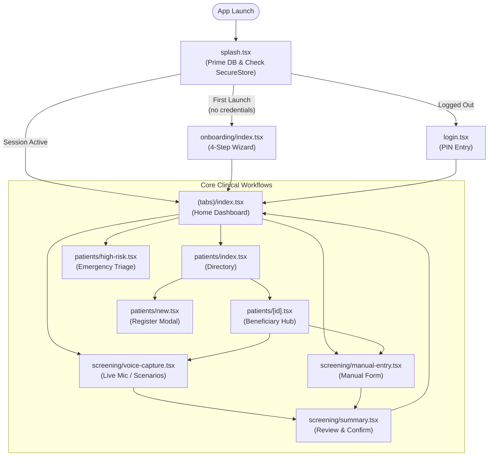

# Mobile Application Architecture & Screen Directory

> **Audience:** Mobile Engineers, React Native Developers, UI/UX Designers  
> **Source Directory:** [`apps/mobile/`](file:///C:/Andy%20projects/Asha/apps/mobile)  
> **Design Blueprint:** [`stitch_asha_ai_copilot_ui/`](file:///C:/Andy%20projects/Asha/stitch_asha_ai_copilot_ui)

---

## 1. Architectural Overview

The mobile frontend is built on **React Native (0.76+)** and **Expo SDK 52** utilizing **Expo Router v4** file-based navigation, **Hermes JS Engine**, and **Expo SQLite (next)**. It is specifically designed to function 100% offline on entry-level Android smartphones (MediaTek Helio P22 / A22, 2GB–4GB RAM, Android 9–14) used by frontline Accredited Social Health Activists (ASHAs) across rural India.

### Core Frontend Principles
1. **Zero Cloud Requirement**: The complete user journey—from onboarding, PIN authentication, beneficiary registration, voice recording, clinical rule evaluation, and visit summary—executes with zero active internet connectivity.
2. **Tactile Functionalism**: Touch targets meet or exceed 48×48dp (`Spacing.touchMin = 48`, `Spacing.touchComfort = 56`). Actionable CTAs feature high-contrast surfaces, bold Devanagari typography, and immediate haptic/visual feedback.
3. **Dual-Script Accessibility**: Every clinical concept and screening field is presented in bilingual Devanagari and English (e.g., `रक्तचाप 165/105 mmHg · Blood Pressure`).
4. **Purple Ban Compliance**: Under strict design system guidelines, violet, purple, and neon gradient palettes are completely forbidden. The palette centers on clinical teal/green (`#0F766E`, `#14B8A6`), urgent amber (`#D97706`), and emergency crimson (`#DC2626`).
5. **Universal Safe Area Integration**: Powered by `SafeAreaProvider` and `react-native-safe-area-context` across all 16 screens. Main tab routes employ `edges={['top', 'left', 'right']}` allowing `@react-navigation/bottom-tabs` to manage bottom gesture bars without double-padding, while all clinical and modal screens enforce full top/bottom safe boundary containment against Android notches, camera cutouts, and system bars.

---

## 2. Navigation Hierarchy & Route Tree

The routing topology is managed by Expo Router v4 under [`apps/mobile/app/`](file:///C:/Andy%20projects/Asha/apps/mobile/app):

```
apps/mobile/app/
├── _layout.tsx                 # Root Stack Navigator & DB Initialization
├── splash.tsx                  # Splash Gate (Auth & Onboarding Inspection)
├── onboarding/
│   └── index.tsx               # 4-Step Interactive Onboarding Wizard
├── login.tsx                   # Role Selection & 4-Digit PIN Authentication
├── (tabs)/                     # Main Bottom Tab Navigator
│   ├── _layout.tsx             # Tab Bar Layout (4 Tabs: Home, Care, Sync, Profile)
│   ├── index.tsx               # Home Dashboard & Daily Visit Targets
│   ├── followups.tsx           # Care Tracking & Scheduled Follow-ups
│   ├── sync.tsx                # Offline Sync Queue & Manual Dispatch
│   └── profile.tsx             # Worker Credentials & Verification Status
├── patients/
│   ├── index.tsx               # Beneficiary Directory & Live Search
│   ├── new.tsx                 # Beneficiary Registration Modal
│   ├── [id].tsx                # Beneficiary Profile & Longitudinal Timeline Hub
│   └── high-risk.tsx           # Emergency Triage & 108 Ambulance Dispatch
├── screening/
│   ├── voice-capture.tsx       # Dual-Mode Voice Capture & Metering Hub
│   ├── summary.tsx             # Human Confirmation & Explainable Rules Summary
│   └── manual-entry.tsx        # Zero-AI Manual Screening Form
└── village/
    └── index.tsx               # Village Coverage & Sub-Center Overview
```



---

## 3. Screen-by-Screen Specification

### 1. `splash.tsx` — Application Gateway
- **File:** [`apps/mobile/app/splash.tsx`](file:///C:/Andy%20projects/Asha/apps/mobile/app/splash.tsx)
- **Role:** First entry point. Initializes the SQLite singleton (`getDatabase()`) and inspects `SecureStore` keys:
  - `has_onboarded`: If missing or false, routes to `/onboarding`.
  - `session_active`: If `'true'`, routes directly to `/(tabs)`.
  - Otherwise routes to `/login`.
- **Fail-Safe:** In the event of any storage read anomaly, safely defaults to `/(tabs)` to prevent blocking field workers.

### 2. `onboarding/index.tsx` — 4-Step Worker Onboarding Wizard
- **File:** [`apps/mobile/app/onboarding/index.tsx`](file:///C:/Andy%20projects/Asha/apps/mobile/app/onboarding/index.tsx)
- **Role:** Interactive setup for newly deployed ASHA tablets/smartphones:
  - **Step 1 (Language):** Selects Hindi (हिंदी), Hinglish, or English.
  - **Step 2 (Profile Setup):** Inputs Worker Name, ASHA ID (`ASHA-UP-402`), Primary Village, Sub-Center, and Mobile Phone.
  - **Step 3 (PIN Creation):** Sets and confirms a 4-digit numeric security PIN.
  - **Step 4 (Offline Tutorial):** Briefs the worker on on-device AI guarantees, microphone usage, and human confirmation rules.
- **Persistence:** Writes credentials to `SecureStore` (`worker_auth_pin`, `worker_profile`, `has_onboarded`, `session_active`) and writes the worker record into the SQLite `workers` table.

### 3. `login.tsx` — Role Authentication
- **File:** [`apps/mobile/app/login.tsx`](file:///C:/Andy%20projects/Asha/apps/mobile/app/login.tsx)
- **Role:** Secure authentication screen supporting two operational roles:
  - *ASHA Worker*: Displays active worker name and village from `SecureStore`.
  - *Supervisor (PHC Medical Officer)*: Displays Medical Officer persona.
- **Features:** 4-digit PIN input with masked dots, account switching link back to onboarding, and offline verification against `worker_auth_pin` (default fallback `'1234'`).

### 4. `(tabs)/index.tsx` — Home Dashboard
- **File:** [`apps/mobile/app/(tabs)/index.tsx`](file:///C:/Andy%20projects/Asha/apps/mobile/app/(tabs)/index.tsx)
- **Role:** Frontline operational command center:
  - **Header:** Displays worker greeting, connectivity status pill (`Online` / `Offline`), and count of synchronized records.
  - **Daily Motivational Strip:** Shows home visits completed vs. daily target (e.g., `8/10 पूर्ण · 80%`).
  - **Audio Briefing Button:** Tactile speaker button providing audio announcement of daily priorities.
  - **Primary CTA ("Start Field Visit"):** 88dp high-contrast button routing directly to Voice Screening.
  - **4-Tile Action Matrix:**
    1. *Patients (मरीज सूची)* -> `/patients`
    2. *High Risk (उच्च जोखिम)* -> `/patients/high-risk`
    3. *Pending Follow-ups (फॉलो-अप)* -> `/(tabs)/followups`
    4. *Offline Sync (सिंक)* -> `/(tabs)/sync`

### 5. `screening/voice-capture.tsx` — Voice Screening Hub
- **File:** [`apps/mobile/app/screening/voice-capture.tsx`](file:///C:/Andy%20projects/Asha/apps/mobile/app/screening/voice-capture.tsx)
- **Role:** The core voice AI interface.
- **Architecture Highlights:**
  - **Dual-Mode Switcher:**
    1. *Live Mic (खुली आवाज़):* Captures real ambient speech via `expo-av` with animated acoustic metering rings.
    2. *Clinical Scenarios (केस परिदृश्य):* Loads pre-recorded clinical test fixtures for repeatable auditing.
  - **Beneficiary Selector:** Horizontal carousel loading registered patients from SQLite, pre-selecting screening category (NCD vs Pregnancy).
  - **Quick Clinical Chips:** 1-tap Hindi speech symptom additions (e.g., `+ बीपी 165/105`, `+ चीनी 185`, `+ रक्तस्राव`).
  - **Native Audio Lifecycle Guard:** Employs `recordingRef`, explicit runtime permission prompts, rapid-tap concurrency locks, and guaranteed audio mode teardown on component unmount.
  - **In-Memory Caching:** Stores screening results in `screeningOrchestrator.setLastResult(result)` to avoid URL query parameter buffer overflows.

### 6. `screening/summary.tsx` — Review & Human Confirmation
- **File:** [`apps/mobile/app/screening/summary.tsx`](file:///C:/Andy%20projects/Asha/apps/mobile/app/screening/summary.tsx)
- **Role:** PRD Section 28 & 106 compliance gate.
- **Features:**
  - Displays transcribed voice narrative and parsed structured parameters.
  - **Editable Vital Fields:** ASHA worker can manually adjust Systolic BP, Diastolic BP, Glucose, Gestational Weeks, or Bleeding switches.
  - **Dynamic Rule Re-evaluation:** Updating numeric vitals re-runs `evaluateRules()` instantaneously on device, updating risk badges in real time.
  - **Explainable Clinical Risk Cards:** Shows bilingual clinical rationale and required next steps.
  - **Qwen 1.7B Summary Card:** Displays concise Hindi summary.
  - **Human-in-the-Loop Checkbox:** Mandatory checkbox confirming worker verification before saving to SQLite.
  - **Automated Follow-up Generation:** If a `high` or `medium` rule triggers, automatically schedules a follow-up task and enqueues both screening and follow-up in the sync queue.

### 7. `patients/[id].tsx` — Beneficiary Profile Hub
- **File:** [`apps/mobile/app/patients/[id].tsx`](file:///C:/Andy%20projects/Asha/apps/mobile/app/patients/[id].tsx)
- **Role:** Longitudinal beneficiary health record.
- **Features:**
  - Demographic header (Name, Age, Sex, Household ID, Village).
  - Quick action buttons to start a new Voice Screening or Manual Screening for this patient.
  - Latest Vitals Bar (Blood Pressure with color-coded status, Blood Glucose).
  - Historical Screening Timeline showing previous visits and rule flags.
  - Pending Follow-up Cards with a 1-tap **"Mark Done"** action that updates SQLite and enqueues a sync update.

### 8. `patients/high-risk.tsx` — Emergency Triage & Referral
- **File:** [`apps/mobile/app/patients/high-risk.tsx`](file:///C:/Andy%20projects/Asha/apps/mobile/app/patients/high-risk.tsx)
- **Role:** Emergency referral desk for high-risk maternal and hypertensive crisis cases.
- **Features:**
  - Instant **"Dial 108"** ambulance CTA triggering native phone dialer (`tel:108`).
  - Filtered list of patients flagged with `high` priority clinical rules.
  - Displays specific Hindi clinical danger reason (e.g., `गर्भावस्था में रक्तस्राव खतरे का लक्षण है`).
  - Clicking any beneficiary card navigates to their profile hub (`/patients/[id]`).

### 9. `(tabs)/followups.tsx` — Care Tracking
- **File:** [`apps/mobile/app/(tabs)/followups.tsx`](file:///C:/Andy%20projects/Asha/apps/mobile/app/(tabs)/followups.tsx)
- **Role:** Schedule management for maternal and chronic disease checkups.
- **Features:**
  - Tab switcher: **Pending (लंबित)** vs **Completed (पूर्ण)**.
  - Direct telephone call button (`Linking.openURL('tel:...')`) to call beneficiary families.
  - "Mark Completed" button that updates local SQLite and enqueues sync payload.

### 10. `(tabs)/sync.tsx` — Sync Queue & Connectivity Desk
- **File:** [`apps/mobile/app/(tabs)/sync.tsx`](file:///C:/Andy%20projects/Asha/apps/mobile/app/(tabs)/sync.tsx)
- **Role:** Visibility into the offline-first sync engine.
- **Features:**
  - Displays total pending records count broken down by entity (`patients`, `screenings`, `followups`).
  - Shows last successful sync timestamp and network status.
  - Editable supervisor backend URL (default `http://127.0.0.1:8000`).
  - **"Sync Now"** manual trigger button with progress indicator and detailed response summary.

### 11. `(tabs)/profile.tsx` — Worker Performance & Credentials
- **File:** [`apps/mobile/app/(tabs)/profile.tsx`](file:///C:/Andy%20projects/Asha/apps/mobile/app/(tabs)/profile.tsx)
- **Role:** Frontline worker dashboard.
- **Features:**
  - ASHA worker credentials loaded from `SecureStore`.
  - Monthly performance metrics grid (Home visits, NCD screenings, ANC checks, High-risk triage count).
  - AI System Integrity certification badges (Local Whisper Tiny, Needle 2, Human-in-the-Loop).
  - Secure Logout action that clears `session_active` and returns to the PIN login screen.

### 12. `screening/manual-entry.tsx` — Zero-AI Screening Form
- **File:** [`apps/mobile/app/screening/manual-entry.tsx`](file:///C:/Andy%20projects/Asha/apps/mobile/app/screening/manual-entry.tsx)
- **Role:** Complete offline fallback when microphone hardware is unavailable or in extremely noisy environments.
- **Features:** Direct numerical entry for BP and Blood Glucose, pregnancy danger symptom toggles, and instant deterministic clinical rule evaluation.

---

## 4. Reusable UI Component System (`components/`)

| Component | File Path | Props & Description |
| :--- | :--- | :--- |
| **`Header`** | [`apps/mobile/components/Header.tsx`](file:///C:/Andy%20projects/Asha/apps/mobile/components/Header.tsx) | Top app bar displaying language toggle (Hindi/English), online indicator, and sync counter badge. |
| **`VoiceDock`** | [`apps/mobile/components/VoiceDock.tsx`](file:///C:/Andy%20projects/Asha/apps/mobile/components/VoiceDock.tsx) | Persistent floating voice interaction dock with animated waveform states (`idle`, `listening`, `processing`, `success`). |
| **`PatientCard`** | [`apps/mobile/components/PatientCard.tsx`](file:///C:/Andy%20projects/Asha/apps/mobile/components/PatientCard.tsx) | Standardized beneficiary card displaying name, age, village, risk pill, and tactile click action. |
| **`RiskCard`** | [`apps/mobile/components/RiskCard.tsx`](file:///C:/Andy%20projects/Asha/apps/mobile/components/RiskCard.tsx) | High-contrast clinical alert card displaying priority badge (`high`/`medium`/`low`), bilingual explanation, and required clinical next steps. |

---

## 5. Theme Tokens & Styling System (`constants/theme.ts`)

- **Palette Definition:**
  ```typescript
  export const Colors = {
    primary: '#0F766E',          // Deep Forest Teal (Main brand & primary CTAs)
    primaryBright: '#14B8A6',    // Vibrant Emerald (Active recording & toggles)
    primaryDark: '#005C55',      // Deep Container Teal
    primaryLight: '#CCFBF1',     // Soft Teal container backgrounds
    background: '#F8FAFC',       // Clean neutral canvas
    surface: '#FFFFFF',          // High-contrast card surface
    surfaceContainer: '#F1F5F9', // Elevated chip container
    danger: '#DC2626',           // Clinical emergency / Maternal danger sign
    dangerLight: '#FEE2E2',      // High-risk badge background
    warning: '#D97706',          // Chronic elevated vital flag
    warningLight: '#FEF3C7',     // Warning badge background
    success: '#16A34A',          // Normal screening / synced status
    successLight: '#DCFCE7',     // Success badge background
    border: '#E2E8F0',           // 1px tactile borders
    textPrimary: '#0F172A',      // High-contrast Devanagari text
    textSecondary: '#475569',    // Secondary metadata
    textMuted: '#94A3B8',        // Disabled / hint text
  };
  ```
- **Touch Spacing Standards:**
  - `Spacing.touchMin = 48`: Strict minimum size for any interactive element.
  - `Spacing.touchComfort = 56`: Primary field action buttons (Record, Save, Dial).
