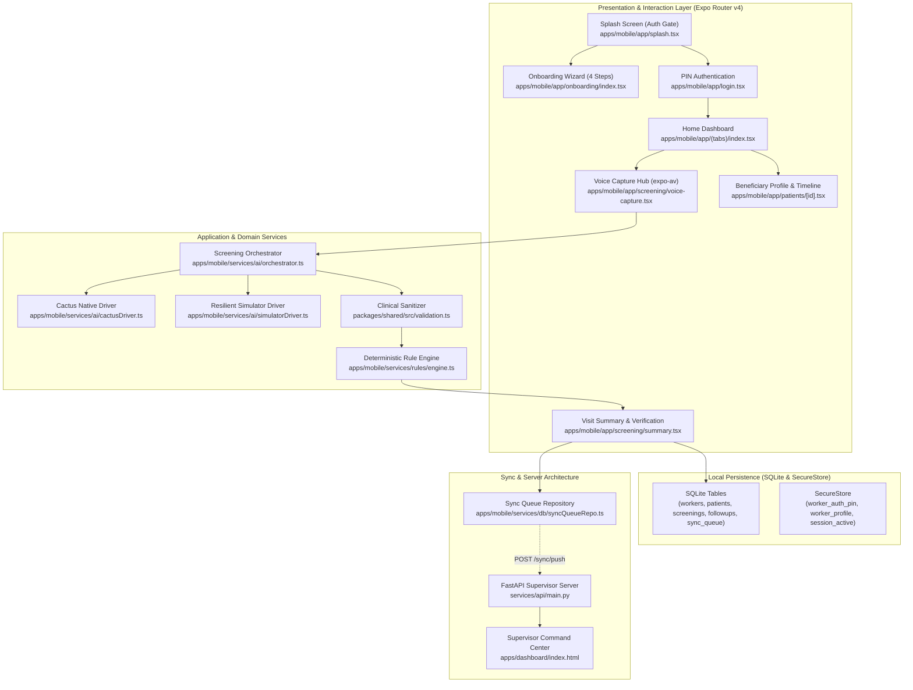
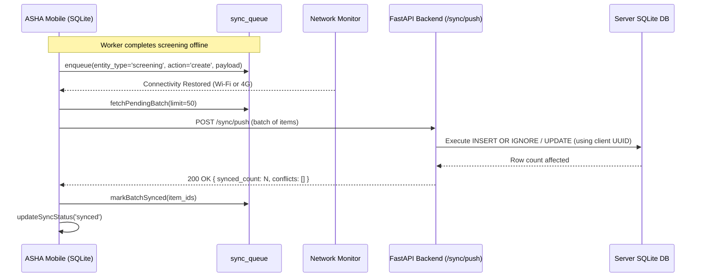

# Principal-Level Architecture Guide

> **Audience:** Senior Engineers, System Architects, Security & Clinical Leads  
> **Repository Context:** `C:\Andy projects\Asha`

---

## 1. System Philosophy & Invariants

ASHA AI Copilot is engineered around four uncompromising architectural invariants:

1. **The Field Invariant (Offline Completeness)**: Under no circumstances does the core clinical screening workflow block on an HTTP network request. Every patient record, voice recording, structured extraction, clinical rule evaluation, and follow-up generation must execute locally and persist immediately to SQLite (`apps/mobile/services/db/database.ts:40`).
2. **The Clinical Safety Invariant (Deterministic Triage)**: Neural language models (LLMs) are strictly forbidden from determining clinical priority (Normal, Medium, High). Clinical scoring is computed exclusively by deterministic rule engines (`services/rules/engine.ts:35`) evaluating JSON protocols (`packages/shared/src/protocols/`). LLMs are confined to transcription and human-friendly explanation generation.
3. **The Privacy Invariant (Ephemeral Audio)**: Raw audio captured during voice consultations is strictly ephemeral. It is processed in memory or stored in temporary sandbox storage and purged once transcription and extraction are verified. Only structured clinical vitals are synced to the supervisor backend (`services/api/main.py:100`).
4. **The Network Invariant (Strict Idempotency)**: Due to fluctuating 2G/3G connectivity in rural sub-centers, network drops are expected during synchronization. Every entity uses client-side UUIDs (`p-${Date.now()}`, `screen-${Date.now()}`) and database upsert semantics so that replaying a sync payload produces the exact same state without duplicates (`services/api/main.py:125`).

---

## 2. Core Architecture & Component Map



---

## 3. Key Abstractions & Interfaces

### 3.1 AI Driver Interface (`apps/mobile/services/ai/types.ts`)
```typescript
export interface AIEngineDriver {
  name: string;
  isAvailable(): Promise<boolean>;
  transcribe(audioUri: string): Promise<string>;
  extractScreeningData(transcript: string, type: ScreeningType): Promise<StructuredScreeningData>;
  generateSummary(payload: SummaryPromptPayload): Promise<string>;
}
```

### 3.2 Clinical Rule Result Model (`packages/shared/src/types.ts`)
```typescript
export interface RuleResult {
  rule_id: string;
  triggered: boolean;
  priority: 'low' | 'medium' | 'high';
  action: 'routine' | 'followup_7d' | 'immediate_referral';
  reason: string;
  reason_hi: string;
  thresholds: Record<string, any>;
  observed: Record<string, any>;
}
```

---

## 4. Local SQLite Database Schema

Located in `apps/mobile/services/db/database.ts`:

```sql
CREATE TABLE IF NOT EXISTS workers (
  id TEXT PRIMARY KEY,
  name TEXT NOT NULL,
  phone TEXT,
  role TEXT DEFAULT 'asha',
  village TEXT,
  sub_center TEXT
);

CREATE TABLE IF NOT EXISTS patients (
  id TEXT PRIMARY KEY,
  name TEXT NOT NULL,
  age INTEGER NOT NULL,
  sex TEXT NOT NULL,
  phone TEXT,
  village TEXT NOT NULL,
  household_id TEXT,
  created_at TEXT NOT NULL,
  updated_at TEXT NOT NULL,
  sync_status TEXT DEFAULT 'pending'
);

CREATE TABLE IF NOT EXISTS screenings (
  id TEXT PRIMARY KEY,
  patient_id TEXT NOT NULL,
  screening_type TEXT NOT NULL,
  transcript TEXT,
  structured_data TEXT NOT NULL,
  rule_results TEXT NOT NULL,
  summary TEXT,
  confirmed INTEGER DEFAULT 0,
  created_at TEXT NOT NULL,
  updated_at TEXT NOT NULL,
  sync_status TEXT DEFAULT 'pending',
  FOREIGN KEY (patient_id) REFERENCES patients(id)
);

CREATE TABLE IF NOT EXISTS followups (
  id TEXT PRIMARY KEY,
  patient_id TEXT NOT NULL,
  screening_id TEXT,
  reason TEXT NOT NULL,
  priority TEXT NOT NULL,
  due_date TEXT NOT NULL,
  status TEXT DEFAULT 'pending',
  created_at TEXT NOT NULL,
  updated_at TEXT NOT NULL,
  sync_status TEXT DEFAULT 'pending',
  FOREIGN KEY (patient_id) REFERENCES patients(id)
);

CREATE TABLE IF NOT EXISTS sync_queue (
  id TEXT PRIMARY KEY,
  entity_type TEXT NOT NULL,
  entity_id TEXT NOT NULL,
  action TEXT NOT NULL,
  payload TEXT NOT NULL,
  status TEXT DEFAULT 'pending',
  retry_count INTEGER DEFAULT 0,
  created_at TEXT NOT NULL
);
```

---

## 5. Idempotent Synchronization Lifecycle



---

## 6. Failure Modes & Resilience Patterns

| Failure Mode | Root Cause | System Mitigation Strategy |
| :--- | :--- | :--- |
| **Microphone Permission Denied** | User denied Android mic permission | App falls back gracefully to manual speech dictation / preset clinical chips without crashing (`voice-capture.tsx:145`). |
| **Native Cactus Binary Missing** | Unsupported chip architecture | `ScreeningOrchestrator` probes `isAvailable()`. If native Cactus runtime is absent, seamlessly falls back to `OfflineSimulatorDriver` (`orchestrator.ts:36`). |
| **Sudden App Termination** | Android OS low-memory killer (LMK) | Form states are stored in component refs; DB writes are wrapped in transactional SQLite `runAsync`. Records are saved before navigating to summary (`summary.tsx:109`). |
| **Intermittent Sync Disconnection** | Rural packet loss during POST | `syncQueueRepo` uses incremental `retry_count`. Unacknowledged records remain in `pending` status and retry on next network change (`sync.tsx:45`). |
| **Database Corruption / Migration** | App upgrade | Auto-seeds demo fixtures using `INSERT OR IGNORE` ensuring existing records are never wiped (`database.ts:60`). |
