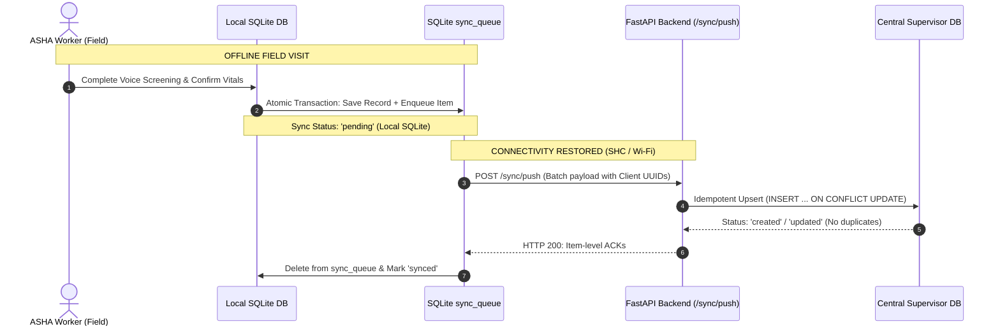
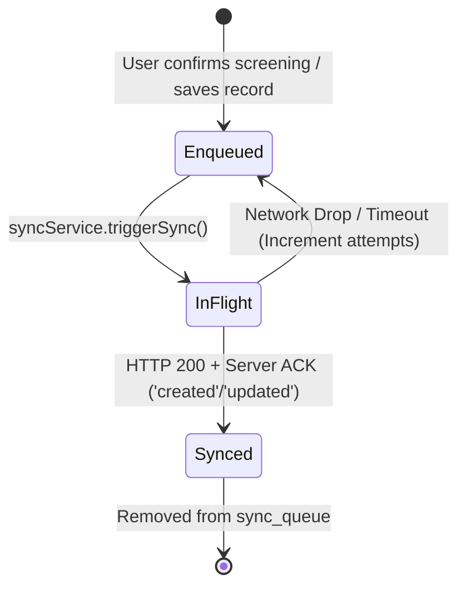

# Synchronization Protocol & Offline-First Multi-Master Engine

> **Audience:** Distributed Systems Engineers, Backend Architects, Mobile Engineers  
> **Mobile Client Service:** [`apps/mobile/services/sync/syncService.ts`](file:///C:/Andy%20projects/Asha/apps/mobile/services/sync/syncService.ts)  
> **Server Endpoint:** [`services/api/main.py`](file:///C:/Andy%20projects/Asha/services/api/main.py)  
> **Test Suite:** [`tests/sync_idempotency_test.py`](file:///C:/Andy%20projects/Asha/tests/sync_idempotency_test.py)

---

## 1. Executive Summary & Design Invariants

Frontline healthcare workers in rural Sub-Health Centres routinely operate with intermittent 2G/3G connectivity or in complete cellular dead zones. The synchronization architecture between the **React Native mobile client** and the **FastAPI supervisor server** is governed by three fundamental invariants:



1. **The Store-and-Forward Invariant**: Under no circumstances does mobile UI flow wait for or block on an HTTP request. All operations write atomically to local SQLite and are buffered in `sync_queue`.
2. **The Strict Idempotency Invariant**: Cellular packets in rural sub-districts frequently drop during HTTP response transmission. The client may retry a batch multiple times. Every entity uses **client-generated UUIDs** and database upsert semantics so that duplicate uploads never create duplicate patient files or ghost records.
3. **The Privacy & Low-Bandwidth Invariant**: Raw audio files are strictly ephemeral and processed locally. Only structured numerical vitals, clinical risk flags, and text summaries are transmitted over the wire (~1.2 KB per visit).

---

## 2. Sync Protocol Lifecycle & State Machine



### Stage 1: Local Enqueueing
When an ASHA worker confirms a screening in [`apps/mobile/app/screening/summary.tsx`](file:///C:/Andy%20projects/Asha/apps/mobile/app/screening/summary.tsx#L133), the client executes a dual-write:
1. Persists the record to `screenings` table with `sync_status = 'pending'`.
2. Inserts a queue item into `sync_queue` table:
   ```typescript
   await syncQueueRepository.enqueue(
     'screening',
     screeningId, // e.g., 'screen-1728219482000'
     'create',
     {
       patient_id: patientId,
       screening_type: screeningType,
       structured_data: currentStructuredData,
       rule_results: dynamicRules,
       summary: summaryText,
       confirmed: true
     }
   );
   ```

### Stage 2: Batch Push (`POST /sync/push`)
The sync engine collects pending queue items and packages them into a `SyncPushPayload`:

```typescript
export interface SyncPushPayload {
  device_id: string;   // e.g. 'device-android-asha-001'
  worker_id: string;   // e.g. 'worker-001'
  records: SyncRecord[];
}

export interface SyncRecord {
  client_record_id: string;
  entity: 'patient' | 'screening' | 'followup' | 'worker';
  operation: 'create' | 'update' | 'delete';
  timestamp: string;
  payload: Record<string, unknown>;
}
```

### Stage 3: Server Upsert & Deduplication
The FastAPI backend iterates through records and executes upsert logic in [`services/api/main.py`](file:///C:/Andy%20projects/Asha/services/api/main.py#L125):

```python
@app.post("/sync/push", response_model=SyncPushResponse)
def sync_push(payload: SyncPushRequest, db: sqlite3.Connection = Depends(get_db)):
    processed = 0
    errors = 0
    items = []

    for record in payload.records:
        entity_id = record.client_record_id
        # Idempotent verification: Check if record already exists
        cursor.execute("SELECT id FROM patients WHERE id = ?", (entity_id,))
        existing = cursor.fetchone()

        if existing:
            # Update existing record without changing primary key
            cursor.execute("""
                UPDATE patients 
                SET name=?, age=?, sex=?, phone=?, village=?, updated_at=?
                WHERE id=?
            """, (...))
            items.append(SyncPushResponseItem(client_record_id=entity_id, status="updated"))
        else:
            # Create new record with client UUID
            cursor.execute("""
                INSERT INTO patients (id, name, age, sex, phone, village, created_at, updated_at)
                VALUES (?, ?, ?, ?, ?, ?, ?, ?)
            """, (...))
            items.append(SyncPushResponseItem(client_record_id=entity_id, status="created"))

    db.commit()
    return SyncPushResponse(processed=processed, errors=errors, items=items)
```

### Stage 4: Client ACK & Queue Purge
Upon receiving HTTP 200 with `status: 'created'` or `status: 'updated'`:
1. The client deletes the item from `sync_queue` table.
2. The client updates the local entity's status: `sync_status = 'synced'`.
3. If the network drops before the response is received, the client simply replays the exact same payload on the next connectivity window. Because the server uses client UUIDs, the replay is safely ignored or updated with zero duplication.

---

## 3. Pull Synchronization (`GET /sync/pull`)

The mobile app and external supervisors can query updates from the central server using `/sync/pull`:

```
GET /sync/pull?since=2026-10-06T12:00:00Z&limit=500&offset=0
```

### Parameters:
- `since` *(optional)*: ISO 8601 UTC timestamp filter (`updated_at > since`).
- `limit` *(optional, default 500, max 1000)*: Maximum number of records per entity.
- `offset` *(optional, default 0)*: Pagination offset.

### Response Schema:
```json
{
  "timestamp": "2026-10-06T14:30:00Z",
  "patients": [],
  "screenings": [],
  "followups": [
    {
      "id": "f-001",
      "patient_id": "p-001",
      "screening_id": "s-001",
      "reason": "Blood Pressure Re-check",
      "priority": "high",
      "due_date": "2026-10-07",
      "status": "completed",
      "notes": "Reviewed at PHC",
      "created_at": "2026-10-06T10:00:00Z",
      "updated_at": "2026-10-06T13:15:00Z",
      "sync_status": "synced"
    }
  ],
  "workers": [],
  "tombstones": [
    {
      "client_record_id": "p-del-001",
      "entity": "patient",
      "timestamp": "2026-10-06T13:20:00Z"
    }
  ]
}
```

---

## 4. Sync Trigger & Concurrency Semantics

### Trigger Architecture
Under the **Field Invariant**, clinical screening workflows must never block on or wait for network connectivity. Sync is strictly user-initiated from the dedicated Sync tab (`apps/mobile/app/(tabs)/sync.tsx`). Background auto-sync is intentionally omitted to avoid battery drain, radio wakes, and unpredictable UI blocking in remote rural environments.

### Idempotency & Conflict Handling
- Pushes are transactionally deduplicated by `client_record_id` (RFC 4122 v4 UUID generated at local queue enqueue time).
- Server uses `INSERT OR REPLACE` with `updated_at = now` (last-write-wins based on arrival timestamp).
- Point-of-care vital screening readings are immutable and keyed to client-generated IDs (`s-xxxx`). Server records track creation and updates safely without duplicate insertion.

---

## 5. Automated Verification & Regression Testing

The sync idempotency engine is tested via [`tests/sync_idempotency_test.py`](file:///C:/Andy%20projects/Asha/tests/sync_idempotency_test.py):

```powershell
$env:PYTHONIOENCODING="utf-8"
python tests/sync_idempotency_test.py
```

### Test Assertions Verified:
1. **Initial Push Test**: Verifies a new batch containing 1 patient, 1 screening, and 1 follow-up returns HTTP 200 with status `created`.
2. **Replay Deduplication Test**: Replays the identical payload a second time; asserts that central database patient count does not increment and returns status `updated`.
3. **Pull Verification Test**: Executes `/sync/pull` and confirms the synchronized entity is returned in server change feed.
