# Troubleshooting, Debugging & Crash Prevention Guide

> **Audience:** Senior Engineers, Mobile Debuggers, QA Automation Leads, Field Support Teams  
> **Repository Context:** `C:\Andy projects\Asha`

---

## 1. Post-Mortem of Major Resolved Crashes

During early field simulations and rigorous feature switching, several critical stability vulnerabilities were identified and resolved. This section documents the exact symptoms, root causes, and architectural remedies.

```mermaid
flowchart TD
    subgraph AudioVulnerability ["1. Native Audio Lock"]
        A1["User navigates back while recording"] --> A2["Closure captures recording=null"]
        A2 --> A3["Hardware mic remains open in Android OS"]
        A3 --> A4["Next mic attempt throws native SIGSEGV/start failed"]
        A4 --> A5["CRASH"]
    end

    subgraph NavigationVulnerability ["2. URL Query Buffer Overflow"]
        B1["Voice analysis finishes"] --> B2["JSON.stringify(result) passed in route params"]
        B2 --> B3["3KB+ Hindi Unicode serialized into URL"]
        B3 --> B4["Android deep link throws URIError/TransactionTooLarge"]
        B4 --> B5["CRASH"]
    end

    subgraph DBVulnerability ["3. SQLite Concurrency Contention"]
        C1["Cold launch mounts multiple screens"] --> C2["All call openDatabaseAsync concurrently"]
        C2 --> C3["Parallel schema migrations lock file"]
        C3 --> C4["SQLiteException: database is locked"]
        C4 --> C5["CRASH"]
    end
```



---

### Issue 1: Native Android Hardware Microphone Lock & Runtime Crash
- **Symptom:** The app abruptly crashed to the Android home screen when opening the Voice Screening feature or when navigating between screens while recording was active.
- **Root Cause:**
  In [`apps/mobile/app/screening/voice-capture.tsx`](file:///C:/Andy%20projects/Asha/apps/mobile/app/screening/voice-capture.tsx), the `useEffect` unmount cleanup had an empty dependency array `[]` and referenced `recording` from React state. Due to JavaScript closure scoping, `recording` was evaluated as `null`. When a worker navigated away, `recording.stopAndUnloadAsync()` was never executed. Android's native `AudioRecord` / `MediaRecorder` remained locked by the orphaned instance. Any subsequent attempt to initialize the microphone caused Android OS to throw `java.lang.RuntimeException: start failed.` in native C++ JNI code, immediately terminating the application process.
- **Architectural Solution:**
  1. Replaced state-dependent recording with a mutable reference: `recordingRef = useRef<Audio.Recording | null>(null)`.
  2. Implemented defensive unmount cleanup:
     ```typescript
     useEffect(() => {
       return () => {
         if (recordingRef.current) {
           const dangling = recordingRef.current;
           recordingRef.current = null;
           dangling.stopAndUnloadAsync().catch(() => {});
         }
         Audio.setAudioModeAsync({
           allowsRecordingIOS: false,
           playsInSilentModeIOS: false,
         }).catch(() => {});
       };
     }, []);
     ```
  3. Added explicit runtime permission checks before hardware acquisition, showing user-friendly prompts instead of letting native media calls throw unhandled security exceptions.
  4. Added concurrency locks (`isStartingRef`, `isProcessingRef`) preventing duplicate native recorder allocations on rapid taps.

---

### Issue 2: Navigation Deep Link Buffer Overflow (`URIError: URI malformed`)
- **Symptom:** Completing voice screening and tapping "AI विश्लेषण करें" caused an instantaneous crash before the Visit Summary screen rendered.
- **Root Cause:**
  The voice capture screen previously serialized the entire AI output into the URL query string: `router.replace({ pathname: '/screening/summary', params: { resultJson: JSON.stringify(result) } })`. Because `result` contains full multi-paragraph Devanagari Hindi text, structured entity schemas, and rule arrays (3KB+ of Unicode text), Android's navigation query string parser threw `URIError: URI malformed` or native `TransactionTooLargeException`.
- **Architectural Solution:**
  1. Implemented in-memory caching in the orchestrator: [`screeningOrchestrator.setLastResult(result)`](file:///C:/Andy%20projects/Asha/apps/mobile/services/ai/orchestrator.ts#L37).
  2. Updated [`apps/mobile/app/screening/summary.tsx`](file:///C:/Andy%20projects/Asha/apps/mobile/app/screening/summary.tsx#L34) to load results from cache directly:
     ```typescript
     let initialResult = screeningOrchestrator.getLastResult();
     if (!initialResult && params.resultJson) {
       try { initialResult = JSON.parse(params.resultJson); } catch {}
     }
     ```
  3. Reduced route parameters to lightweight identifiers (`patientId`, `patientName`, `screeningType`).

---

### Issue 3: Concurrent SQLite Database Lock Race Condition
- **Symptom:** Intermittent crashes on cold app startup with `SQLiteException: database is locked`.
- **Root Cause:**
  [`apps/mobile/services/db/database.ts`](file:///C:/Andy%20projects/Asha/apps/mobile/services/db/database.ts) initialized SQLite via an un-guarded async function. When the root layout, dashboard, patients tab, and follow-ups tab loaded concurrently on application startup, multiple calls to `openDatabaseAsync()` and `initDatabase()` ran simultaneously on the same file descriptor, triggering database lock contention.
- **Architectural Solution:**
  Enforced a Promise-based Singleton pattern (`dbPromise`):
  ```typescript
  let dbPromise: Promise<SQLite.SQLiteDatabase> | null = null;

  export function getDatabase(): Promise<SQLite.SQLiteDatabase> {
    if (!dbPromise) {
      dbPromise = (async () => {
        try {
          const db = await SQLite.openDatabaseAsync(DB_NAME);
          await initDatabase(db);
          return db;
        } catch (err) {
          dbPromise = null; // Reset on failure
          throw err;
        }
      })();
    }
    return dbPromise;
  }
  ```

---

### Issue 4: Corrupt JSON / Parsing SyntaxError Crashes
- **Symptom:** Navigating to the Home Dashboard or Beneficiary Hub crashed if any previous screening contained an empty or malformed string.
- **Root Cause:**
  In [`screeningRepo.ts`](file:///C:/Andy%20projects/Asha/apps/mobile/services/db/screeningRepo.ts), rows were mapped using raw `JSON.parse(row.structured_data)` and `JSON.parse(row.rule_results)`. If a row had null or an empty string, an unhandled `SyntaxError` crashed the screen.
- **Architectural Solution:**
  Added safe fallback parser across all repository mapping loops:
  ```typescript
  function safeJsonParse<T>(raw: string | null | undefined, fallback: T): T {
    if (!raw || typeof raw !== 'string') return fallback;
    try {
      return JSON.parse(raw);
    } catch {
      return fallback;
    }
  }
  ```

---

### Issue 5: Missing Stack Registrations & Bare `router.back()` Failures
- **Symptom:** Tapping the Back arrow threw `Error: GO_BACK was not handled by any navigator` or crashed navigation.
- **Root Cause:**
  Screens [`onboarding/index`](file:///C:/Andy%20projects/Asha/apps/mobile/app/onboarding/index.tsx) and [`patients/[id]`](file:///C:/Andy%20projects/Asha/apps/mobile/app/patients/[id].tsx) were omitted from the root stack definition in [`apps/mobile/app/_layout.tsx`](file:///C:/Andy%20projects/Asha/apps/mobile/app/_layout.tsx#L27). Furthermore, when a user arrived at `/screening/summary` via `router.replace()`, calling bare `router.back()` failed because no previous screen existed on that history stack.
- **Architectural Solution:**
  1. Registered all routes explicitly in `<Stack.Screen>`.
  2. Replaced bare `router.back()` calls across screens with guarded fallbacks:
     ```typescript
     const handleBack = () => {
       if (router.canGoBack()) {
         router.back();
       } else {
         router.replace('/(tabs)');
       }
     };
     ```

---

### Issue 6: Table Schema Column Mismatches in Onboarding
- **Symptom:** Completing Step 4 of the onboarding wizard threw a SQLite error.
- **Root Cause:**
  `onboarding/index.tsx` inserted into `workers (id, name, phone, role, village, sub_center, created_at)`, but the table schema defined in `database.ts` lacked the `sub_center` column.
- **Architectural Solution:**
  Added `sub_center TEXT` to the table schema and executed a safe column migration (`ALTER TABLE workers ADD COLUMN sub_center TEXT;`) in `database.ts:initDatabase`.

---

### Issue 7: Cross-Route Navigation Crash in `getPathDataFromState` (`TypeError: undefined is not a function`)
- **Symptom:** In production release APK, navigating from Home to `/patients` or `/screening/voice-capture` killed the app immediately with:
  ```text
  FATAL EXCEPTION: mqt_native_modules
  Process: org.health.asha.aicopilot
  JavascriptException: TypeError: undefined is not a function
    in BaseNavigationContainer > NavigationContainerInner > ContextNavigator > ExpoRoot
    _loop → getPathDataFromState → getRouteInfoFromState → getRouteInfo → updateState
  ```
- **Root Cause:**
  Dependency mismatch in `query-string`. In `apps/mobile/package.json`, `query-string@^9.5.1` was installed. Version 9.x is pure ESM and exports its methods under `default`, meaning `require('query-string').stringify` evaluates to `undefined`. When Expo Router's `getPathFromState.js` serialized route parameters (`focusedParams`) via `queryString.stringify(focusedParams)`, Hermes threw a fatal `TypeError: undefined is not a function`.
- **Architectural Solution:**
  1. Downgraded and exact-pinned `query-string` to `7.1.3` (CommonJS compatible with Expo Router v4 and React Navigation) across root and mobile workspaces.
  2. Applied defensive fallback patching via `scripts/patch-expo-router.js` (`const stringifyFn = queryString.stringify || queryString.default?.stringify;`) to protect `getPathFromState.js`, `getPathFromState-forks.js`, and `routeInfo.js`.
  3. Integrated `postinstall` hook in root `package.json` to guarantee patch persistence across clean environment installs.

---

## 2. Diagnostic & Debugging Toolkit

### Real-Time ADB Logcat Inspection
To inspect live logs from a connected Android device filtering for React Native, Expo Audio, and SQLite:

```powershell
# Filter for app crashes and audio events
adb logcat *:S ReactNative:V ReactNativeJS:V ExpoAV:V AndroidRuntime:E
```

### Inspecting Local SQLite Database on Device
```powershell
# Open interactive SQLite shell on Android device
adb shell "run-as org.health.asha.aicopilot sqlite3 /data/data/org.health.asha.aicopilot/databases/asha_copilot.db"

# Query record counts
sqlite> SELECT COUNT(*) FROM patients;
sqlite> SELECT COUNT(*) FROM screenings;
sqlite> SELECT COUNT(*) FROM followups;
sqlite> SELECT COUNT(*) FROM sync_queue;
```

### Verifying APK Signature
```powershell
$env:ANDROID_HOME = "C:\Users\naman\AppData\Local\Android\Sdk"
$apksigner = Get-ChildItem -Path "$env:ANDROID_HOME\build-tools" -Filter "apksigner.bat" -Recurse | Select-Object -First 1 -ExpandProperty FullName
& $apksigner verify --verbose "dist\ASHA-AI-Copilot-v1.0.0-release.apk"
```

### Issue 4: React Navigation Route Crash (`TypeError: undefined is not a function` in `getPathDataFromState`)
- **Symptom:** Cross-route navigation pushes from Home to `/patients`, `/screening/voice-capture`, or `/patients/high-risk` caused a fatal Hermes runtime crash: `FATAL EXCEPTION: mqt_native_modules JavascriptException: TypeError: undefined is not a function in getPathDataFromState`.
- **Root Cause:**
  `query-string` was drifted to `^9.5.1` which is pure ESM. Under React Native 0.76 and Hermes on Android, React Navigation's linking serialization invokes `queryString.stringify`. With v9, the function import was undefined, throwing during route serialization. Additionally, `react-native-screens` was mismatched.
- **Architectural Solution:**
  1. Pinned `query-string` strictly to `7.1.3` (CommonJS compatible with Hermes runtime).
  2. Aligned `react-native-screens` to SDK 52's `~4.4.0`.
  3. Rebuilt and verified all route transitions with release APK.

### Issue 5: Dynamic Data Aggregation & Removal of Hardcoded Dummy Numbers
- **Symptom:** The UI previously showed static placeholder values (`8/12` daily goal, `142/64/28/6` monthly performance, static village populations) regardless of actual screening or patient state.
- **Architectural Solution:**
  1. Implemented aggregation queries in SQLite repositories (`screeningRepo.getMetrics()`, `patientRepo.getCount()`, `patientRepo.getVillageBreakdown()`, `followupRepo.getCounts()`).
  2. All screens now reactively query live database state on focus (`useFocusEffect`).
  3. Performing a screening immediately updates Home Dashboard targets, risk alerts, and follow-up schedules.

### Issue 6: Monolingual Architecture & Elimination of Dual-Language Bracket Clutter
- **Symptom:** Strings were cluttered with dual-language brackets like `नाम (Name) · English` or stacked English subtitles below Hindi, causing text overflow on standard 360-412dp Android devices.
- **Architectural Solution:**
  1. Created [`LanguageContext.tsx`](file:///C:/Andy%20projects/Asha/apps/mobile/context/LanguageContext.tsx) with persistent language state stored in `expo-secure-store`.
  2. Provided typed monolingual dictionaries in [`translations.ts`](file:///C:/Andy%20projects/Asha/apps/mobile/constants/translations.ts).
  3. When Hindi is selected, the entire UI renders natural Hindi. When English is selected, it renders natural English. Zero bracket strings.

### Issue 7: Universal SafeAreaView Layouts & Frontline Mobile Density
- **Symptom:** Elements rendered dangerously close to Android status bars and navigation bars, or overflowed due to missing `flexShrink`.
- **Architectural Solution:**
  1. Wrapped all 17 screens in `SafeAreaView` from `react-native-safe-area-context` with `edges={['top', 'left', 'right']}`.
  2. Added explicit `flex: 1`, `flexShrink: 1` to text title columns, and `flexWrap: 'wrap'` to metadata chips to guarantee zero screen overflow on frontline mobile viewports.

---

## 3. Developer FAQ & Common Pitfalls

1. **Q: The microphone does not capture audio in an x86 Android Emulator.**  
   *A:* Android Virtual Devices (AVDs) require virtual microphone input to be enabled in Emulator Settings: **Extended Controls -> Microphone -> Virtual microphone uses host audio input**. If unavailable, switch to the **केस परिदृश्य (Clinical Scenarios)** tab in the app, which uses deterministic audio fixtures.

2. **Q: How do I completely wipe and reset the local SQLite database during testing?**  
   *A:* In your Android terminal run:
   ```powershell
   adb shell "pm clear org.health.asha.aicopilot"
   ```
   This clears both `expo-secure-store` and `asha_copilot.db`, resetting the app to the initial Onboarding Wizard on next launch.

3. **Q: Why does the app use `router.replace` instead of `router.push` when completing a screening?**  
   *A:* Once a clinical screening is analyzed, the worker must not be able to "back-navigate" into an active recording session with stale state. `router.replace` unmounts the recording screen and transitions atomically to review.
