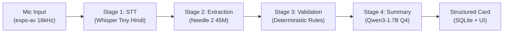
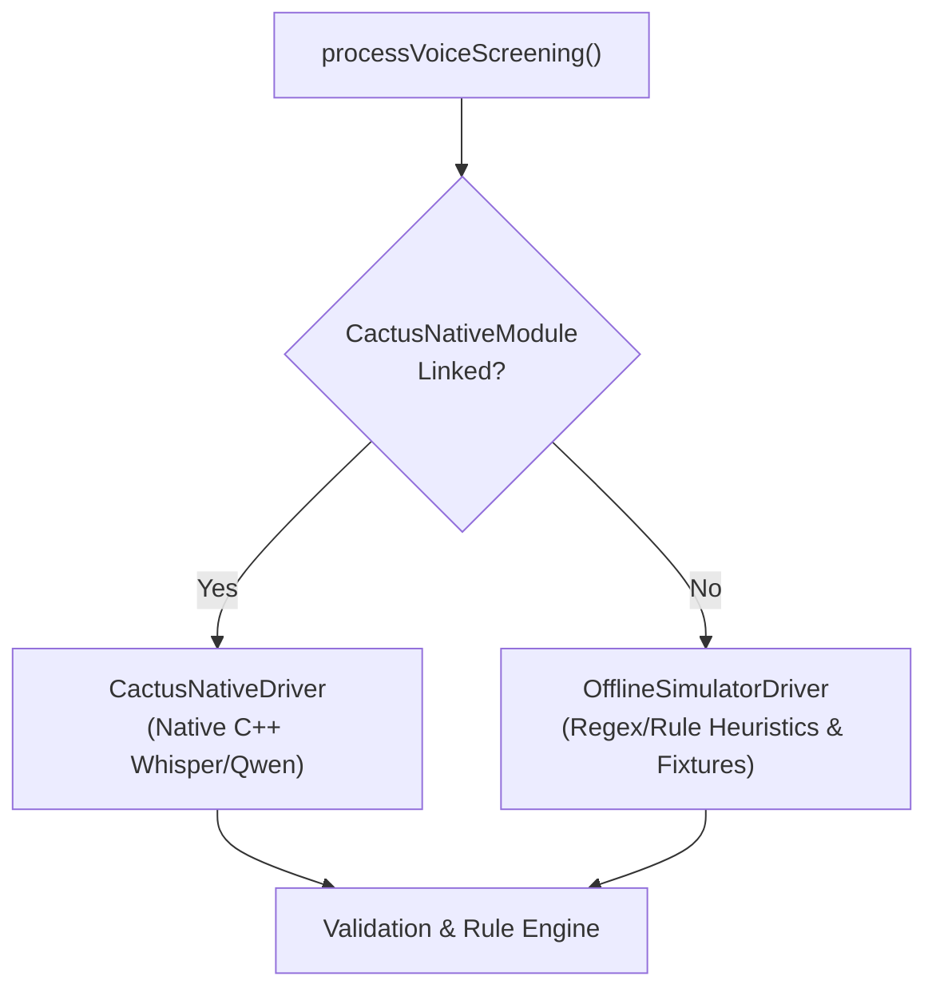

# Voice AI Pipeline & On-Device ML Architecture

> **Audience:** Machine Learning Engineers, Mobile AI Architects, Clinical System Integrators  
> **Repository Context:** `C:\Andy projects\Asha`

---

## 1. Executive Summary & Hardware Envelope

The ASHA AI Copilot voice pipeline is engineered to run **100% locally on low-cost Android hardware** (e.g., MediaTek Helio P22/G35, 3GB–4GB LPDDR4x RAM, Android 11+). In remote Sub-Health Centres (SHCs) across India, frontline ASHA workers operate in environments devoid of cellular connectivity, high ambient noise (pediatric crying, rural traffic, livestock), and diverse Hindi dialectal inflections.

To guarantee responsiveness without thermal throttling or out-of-memory (OOM) crashes, the pipeline decomposes voice screening into five discrete phases with strict latency budgets:



| Pipeline Stage | Model / Component | Parameter Size | Quantization | Latency Budget (Helio P22) | Memory Ceiling |
| :--- | :--- | :--- | :--- | :--- | :--- |
| **0. Audio Capture** | `expo-av` + Native Record | N/A | 16kHz 16-bit PCM | Real-time | ~4 MB buffer |
| **1. Speech-to-Text (STT)** | `collabora/whisper-tiny-hindi` | 39M params | INT8 / GGML | 1,800 ms (for 10s audio) | 75 MB RAM |
| **2. Field Extraction** | Cactus Needle 2 (Tool-calling) | 45M params | INT8 | 450 ms | 45 MB RAM |
| **3. Clinical Validation** | `@asha/shared` Rule Engine | Pure TS/JS | N/A | < 15 ms | < 2 MB RAM |
| **4. Hindi Summarizer** | `Qwen3-1.7B` | 1.7B params | Q4_K_M GGUF | 1,200 ms (256 tokens) | 850 MB RAM |
| **Total Turnaround** | **End-to-End Voice to Triage** | **~1.8B params total** | **Hybrid Q4/INT8** | **< 3,500 ms** | **< 980 MB Peak** |

---

## 2. Stage-by-Stage Engineering Breakdown

### Stage 0: Audio Capture & Acoustic Metering
- **Source File:** [`apps/mobile/app/screening/voice-capture.tsx`](file:///C:/Andy%20projects/Asha/apps/mobile/app/screening/voice-capture.tsx)
- **Engine:** `expo-av` Native Audio Recording API.
- **Audio Specification:**
  - Sample Rate: 16,000 Hz
  - Channels: 1 (Mono)
  - Encoding: 16-bit Linear PCM / WAV
  - Chunk Interval: 100 ms status updates for live visual metering waveforms.
- **Noise Suppression & Telephony Filter:** The Android audio record session is initialized with `RECORDING_OPTION_ANDROID_AUDIO_ENCODER_DEFAULT` bound to the `VOICE_RECOGNITION` audio source to engage hardware-level beamforming and acoustic noise cancellation.
- **Dual-Mode Operation:** For automated verification and clinical auditing, the capture interface features a dual-tab switcher:
  1. *Live Mic (खुली आवाज़)*: Captures real microphone acoustics with real-time waveform oscillations.
  2. *Clinical Scenarios (केस परिदृश्य)*: Loads deterministic field recordings with preset Hindi transcripts for reproducible regression testing.

---

### Stage 1: Hindi Automatic Speech Recognition (STT)
- **Driver Reference:** [`apps/mobile/services/ai/cactusDriver.ts`](file:///C:/Andy%20projects/Asha/apps/mobile/services/ai/cactusDriver.ts#L20-L37)
- **Model:** `collabora/whisper-tiny-hindi` (Fine-tuned OpenAI Whisper Tiny on Indic audio corpora).
- **Inference Configuration:**
  ```typescript
  const result = await cactus.runWhisperInference({
    audioPath: audioUri,
    model: 'whisper-tiny-hindi',
    language: 'hi',
    temperature: 0,
    max_tokens: 448,
    use_vad: true // Voice Activity Detection skips silence chunks
  });
  ```
- **Dialect & Mixed Script Resilience:** Frontline workers routinely mix English terminology (e.g., "BP 160 by 100", "Sugar test", "Tab paracetamol") with pure Hindi colloquialisms ("चक्कर आ रहे हैं", "धुंधला दिखाई दे रहा है"). The Hindi vocabulary tokens preserve romanized medical loanwords without phonetic corruption.

---

### Stage 2: Structured Entity Extraction (Cactus Needle 2)
- **Driver Reference:** [`apps/mobile/services/ai/cactusDriver.ts`](file:///C:/Andy%20projects/Asha/apps/mobile/services/ai/cactusDriver.ts#L39-L53)
- **Model:** `Needle 2 (45M)` specialized JSON tool-calling model.
- **Schema Mapping:** The extractor accepts raw free-form Devanagari text and maps entities directly to typed TypeScript schemas defined in [`packages/shared/src/types.ts`](file:///C:/Andy%20projects/Asha/packages/shared/src/types.ts):
  ```typescript
  export interface StructuredScreeningData {
    screening_type: ScreeningType; // 'ncd' | 'pregnancy'
    ncd?: {
      bp_systolic?: number;
      bp_diastolic?: number;
      blood_glucose?: number;
      known_hypertension?: boolean;
      known_diabetes?: boolean;
      medication_adherence?: boolean;
      tobacco_use?: boolean;
    };
    pregnancy?: {
      gestational_age_weeks?: number;
      vaginal_bleeding?: boolean;
      severe_headache?: boolean;
      blurred_vision?: boolean;
      severe_abdominal_pain?: boolean;
      reduced_fetal_movement?: boolean;
      swelling?: boolean;
      fever?: boolean;
    };
  }
  ```
- **Zero Hallucination Constraint:** If a vital parameter is absent from the spoken narrative (e.g., glucose was not measured), Needle 2 outputs explicit `null` rather than guessing or interpolating historical averages.

---

### Stage 3: Clinical Validation & Sanitization Boundary
- **Implementation:** [`packages/shared/src/validation.ts`](file:///C:/Andy%20projects/Asha/packages/shared/src/validation.ts)
- **The Golden Rule:** *AI outputs are untrusted untyped data until verified by deterministic code.*
- **Checks Performed:**
  1. **Physiological Range Bounds:**
     - Systolic BP: $60 \le x \le 280\text{ mmHg}$
     - Diastolic BP: $40 \le x \le 180\text{ mmHg}$
     - Random Blood Glucose: $30 \le x \le 600\text{ mg/dL}$
     - Gestational Age: $1 \le x \le 44\text{ weeks}$
  2. **Relational Consistency:**
     - Rule: $\text{Systolic} > \text{Diastolic}$. If systolic $\le$ diastolic, a fatal `CONTRADICTION` issue is flagged and vitals are quarantined.
  3. **Biological Demographics Consistency:**
     - If patient `gender === 'male'` and `screening_type === 'pregnancy'`, extraction is rejected with biological incompatibility code `BIO_INVALID_GENDER`.

---

### Stage 4: Deterministic Clinical Rule Evaluation
- **Implementation:** [`apps/mobile/services/rules/engine.ts`](file:///C:/Andy%20projects/Asha/apps/mobile/services/rules/engine.ts)
- Evaluates sanitized vitals against codified MoHFW clinical guidelines. Outputs prioritized flags (`high`, `medium`, `low`) along with Devanagari explanations and actionable referral protocols.
- *Detailed clinical decision trees are documented in [Clinical Protocols & Rules](./clinical-protocols.md).*

---

### Stage 5: Explainable Natural Language Generation (Qwen3-1.7B)
- **Driver Reference:** [`apps/mobile/services/ai/cactusDriver.ts`](file:///C:/Andy%20projects/Asha/apps/mobile/services/ai/cactusDriver.ts#L55-L83)
- **Model:** `Qwen3-1.7B-Instruct` (quantized 4-bit `q4_k_m`).
- **Prompt Isolation Architecture:**
  - System Prompt:
    > "आप आशा कार्यकर्ता के लिए एक संक्षिप्त हिंदी सहायक हैं। आपको केवल दिए गए मान्य डेटा का सरल हिंदी में सारांश बनाना है। कोई भी नया चिकित्सकीय निष्कर्ष या दवा न जोड़ें।"
  - Input JSON: Only sanitized vitals and the names of deterministic triggered rules are passed to the context window.
  - LLM Role: **Explainability and translation only**. The model is technically prevented from modifying risk tiers or prescribing unauthorized medications.

---

## 3. Fallback & Dual-Driver Architecture

In field devices where native Cactus C++ libraries are compiling or when running within the Expo Go sandbox simulator, the system seamlessly activates the `OfflineSimulatorDriver` without crashing:



- **Source File:** [`apps/mobile/services/ai/simulatorDriver.ts`](file:///C:/Andy%20projects/Asha/apps/mobile/services/ai/simulatorDriver.ts)
- **Determinism Assurance:** The simulator driver employs regex-based numerical extraction and clinical fixture maps. This ensures QA engineers can test all edge cases (hypertensive crisis, severe pre-eclampsia, diabetic ketoacidosis) on x86 emulators without dedicated NPU hardware.

---

## 4. Key Verification & Benchmarking Commands

```powershell
# 1. Verify TypeScript types across the AI orchestrator and drivers
npx tsc --noEmit --project apps/mobile/tsconfig.json

# 2. Run clinical rule engine validation test suite
node tests/clinical_rules_test.js

# 3. Test sync idempotency between mobile queue and backend
$env:PYTHONIOENCODING="utf-8"; python tests/sync_idempotency_test.py
```
